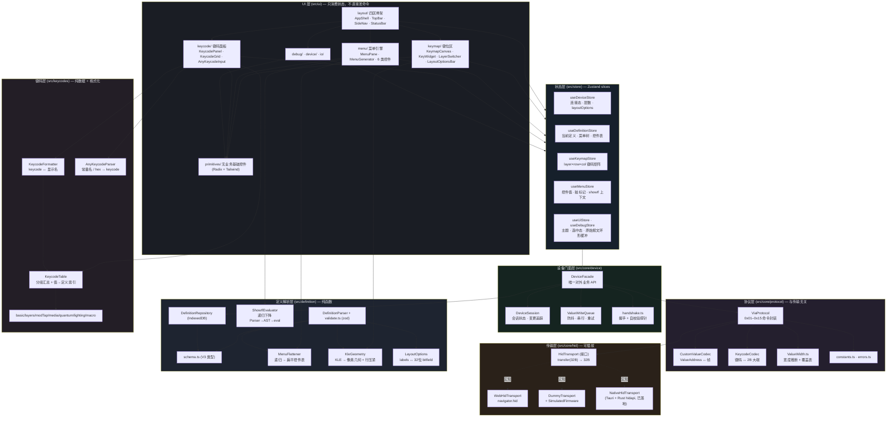
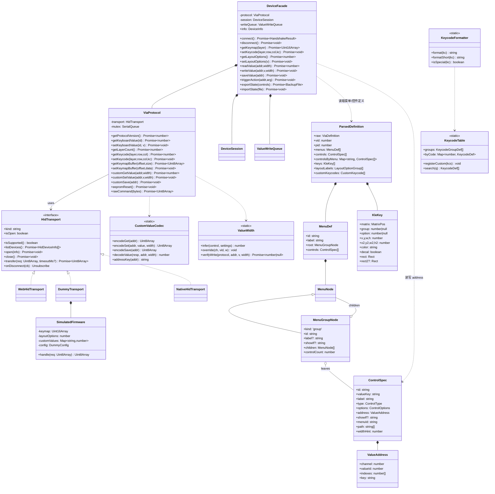
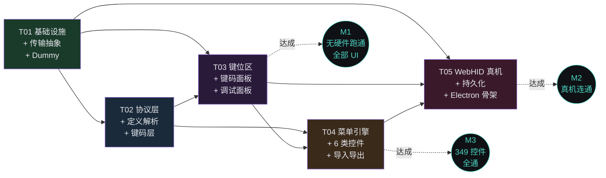

# keydriver 系统架构设计

> ⚡ **现状更新（2026-10-12）**：本文 §1.2/§1.3 的「Tauri 否决 / node-hid P2 预留」为**早期决策，已被覆盖**。
> 现状：**双外壳变体** —— 主版 `keydriver`（Electron + WebHID）与 Lite `keydriver-lite`（Tauri v2 + Rust hidapi 桥，.app 3.5M）。
> Lite 通过 `NativeHidTransport` 实现既有 `HidTransport` 接口的 `'nodehid'` 预留位（`src/core/hid/index.ts` 工厂激活），
> 前端代码零改动，7 层单向依赖与传输接缝设计经受住了迁移检验。下文其余内容仍为有效架构蓝图。

> 文档版本：v1.0
> 撰写：高见远（架构师）
> 项目根目录：`/Users/baoru/Downloads/AI/keydriver`
> 上游输入：`docs/PRD.md`（许清楚，v1.0）、`definitions/7-19-Em60_cn.json`
> 目标读者：工程师（施工蓝图）

---

## 0. 架构师前置实测结论（对 PRD 的补充与修正）

我对 `7-19-Em60_cn.json` 做了逐字段程序化解析，实测结果如下。**其中 5 条是 PRD 未覆盖、且会直接改变实现方式的结论，工程师必须遵守。**

| #      | 实测结论                                      | 数据                                                                                                        | 对架构的影响                                                                                                                                                                          |     |                                  |
| ------ | ----------------------------------------- | --------------------------------------------------------------------------------------------------------- | ------------------------------------------------------------------------------------------------------------------------------------------------------------------------------- | --- | -------------------------------- |
| **F1** | **`valueKey`（`content[0]`）不唯一，存在 2 处重复**  | `id_save_threshold_data`（两个 button，options 分别 `[0]`/`[1]`）、`id_magic_oneshot_enable`（两个 toggle，同一地址 7:12） | ❗**禁止用 valueKey 作为 React key / store 主键 / 缓存键**。控件唯一 ID 必须由「菜单路径 + 序号」生成；valueKey 仅作 `showIf` 求值上下文的变量名                                                                         |     |                                  |
| **F2** | **`showIf` 也作用于分组节点，不只是叶子控件**             | 2 个无名条件分组（`{showIf:"{id_actuation_mode} == 0", content:[...]}`，**无 `label` 字段**）；叶子节点带 `showIf` 的 58 个    | 菜单引擎必须在 **group 层** 与 **leaf 层** 都求值；分组节点 `label` 可选，缺省时应内联展开（不渲染子标题）                                                                                                           |     |                                  |
| **F3** | **菜单用 `content` 承载子节点，没有 `children` 字段**  | 8 个顶层菜单全部为 `{label, content:[...]}`                                                                       | Schema 定义里子节点字段名是 `content`，不是 VIA 官方文档的 `children`。Parser 需同时兼容两者                                                                                                              |     |                                  |
| **F4** | **`showIf` 语法子集极窄**                       | 60 条表达式只用到 `{var}`、`==`、`!=`、`&&`、整数字面量                                                                   | 引擎实现完整子集（含算术/括号/比较/`                                                                                                                                                            |     | `）以备通用，但本文件可用极简路径覆盖，单测优先覆盖这 60 条 |
| **F5** | **`range` 的 max 只有 3 种取值，min 有 0 与 1 两种** | max ∈ {`255`, `1000`, `1023`}；完整组合 5 种：`[0,255]`×21、`[1,255]`×22、`[0,1000]`×22、`[1,1000]`×10、`[1,1023]`×3 | ①「max > 255 → 2 字节」推断规则在本文件上 100% 可判定，无歧义区间；② ⚠️ **min 可能是 1**，滑块下限必须取 `options[0]`（写死 0 与写死 1 都是错的）；③ ⚠️⚠️ **min 维度与字节宽度维度是两个独立维度**，实测计数恰好都是 43/35 属**数值巧合**（两集合交集仅 13），禁止互相推导 |     |                                  |

**其他实测数据（用于验收断言）**

```
menus        : 8 个顶层菜单 / 67 个分组节点 / 349 个叶子控件
控件类型     : keycode 131 | toggle 90 | range 78 | dropdown 33 | button 9 | color 8
content 长度 : button 3 | color 3,4 | dropdown 3,4 | keycode 4,5 | range 3,4 | toggle 3,4
               ── 长度 × 类型 交叉分布（合计 349）──
                 dropdown : len3→3    len4→30
                 range    : len3→26   len4→52
                 toggle   : len3→22   len4→68
                 button   : len3→9              ← 仅 len3，button 不带索引
                 color    : len3→1    len4→7
                 keycode  :           len4→91   len5→40   ← 最短为 4，从不为 3
                 （⚠️ 仅作快速校验用，不得写死；编解码仍以 content.length 实际取值为准）
                 （推论：keycode 必定带 ≥1 个索引；40 个 len5 = Combos 4 输入键 × 10 组
                   id_dynamic_combos_keys[n][k] 二维索引，与 channel 10 分析互为印证）
channel      : 0(16) 3(4) 5(1) 6(32) 7(14) 8(40) 9(106) 10(61) 12(19) 13(19) 14(37)   [11 未出现]
value_id 范围: ch0:1-33 ch3:1-4 ch5:1 ch6:1-5 ch7:1-13 ch8:0-33 ch9:0-7 ch10:0-3 ch12:1-6 ch13:1-6 ch14:1-9
options 形态 : dropdown → string[](2 个, 值=索引) 与 [label,value][](31 个)
               range    → number[] 恒为 [min,max]；5 种组合精确计数：
                          [0,255]×21  [1,255]×22  [0,1000]×22  [1,1000]×10  [1,1023]×3  (=78)
                          ⚠️ min 可能是 1 —— 滑块下限必须取 options[0]，禁止写死 0
               ⚠️⚠️ range 的两个独立维度（数值巧合，务必别混为一谈）：
                          min   维度 : min=0 → 43   min=1 → 35   (和 78)
                          字节宽度维度: 1字节 → 43   2字节 → 35   (和 78)
                          两维度都是 43/35，但**语义完全无关**：实测「min=1 的控件集合」与
                          「需 2 字节的控件集合」交集仅 13 个，并非同一批控件。
                          禁止由「min=1」推导字节宽度，也禁止由「2 字节」推导 min。
                          2 字节的 35 个 = max=1000 的 32 个（[0,1000]22 + [1,1000]10）
                                          + max=1023 的 3 个（[1,1023]×3）
                          ⚠️ 若把两维度混为一谈，**误判面 44/78（过半）**，拆分：
                            min=1 但实为 1 字节 → 被误判成 2 字节 : 22 个  [1,255]
                            min=0 但实为 2 字节 → 被误判成 min=1 : 22 个  [0,1000]
                            不受影响（同属两集合）               : 13 个
                            不受影响（均不属）                   : 21 个  [0,255]
                            校验 22+22+13+21 = 78 ✅
               toggle   → 恒为 null
               button   → number[](8 个：[0]×7、[1]×1) 或 null(1 个)  ← 值不恒为 0，须原样透传
               keycode  → 恒为 null
               color    → 恒为 null
layouts.labels: 5 组 → ["退格键","HHKB分裂退格","2u退格"] / "分裂左shift" / "大回车" / ["右shift","HHKB","2.25U"] / ["配列选择","True hhkb","WK","WKL","HHKB","7U WK"]
               （string = 2 选开关；array 的 [0] 是组名，[1..] 是选项）
keymap       : 9 行 KLE，第 0–3 行主区，第 4–8 行为 row4 的 5 种配列变体
customKeycodes: 2 个（键盘锁 / WIN锁），含 name/title/shortName，shortName 含 "\n"
最大嵌套深度 : 菜单(0) → 分组(1) → 条件分组(2) → 控件(3)
```

> **⚠️ 数字来源约定（团队纪律）**
> 本表及本文档中的**所有统计数字，一律以 `scripts/verify-definition-stats.mjs` 的脚本输出为准，禁止人工归并**。
> 立此约定是因为本项目已出现过两次人工归并错误（button options `[1]` 被并入 `[0]`；range 需 2 字节数把 max=1023 的 3 个漏加）。这两类错误都不会导致程序报错，只会让文档与实现悄悄对不上。
> 复跑方式：`node scripts/verify-definition-stats.mjs definitions/7-19-Em60_cn.json`
> 验收判据：**全部断言通过 + 退出码 0**。⚠️ **不锁定断言条数**——条数是脚本的属性而非定义文件的属性，
> 当前为 23 条，随脚本演进而增加；本文档与 PRD 只约束「结果」（全绿 + 退出码 0），不约束「规模」。
> （此前曾把「19 条」写进文档，脚本升到 23 条后该描述立即过期——这正是我们要堵的"人工维护数字"口子。）
> 换新定义文件时，脚本会输出实际值并逐条标出与基线不符的断言——**此时以脚本输出为准更新文档，不要反过来改断言去迁就文档**。
> **建议纳入 CI**（与 `check-no-hardcode.mjs` 并列挂到 `npm run check`）：放进 CI 的价值大于放进文档——
> 它根治的不只是"算错"，更主要的是"同一事实在多处表述打架"。
>
> **数字三类分治**（与 PRD v1.4 对齐）：
> | 类别 | 例子 | 处理 |
> | --- | --- | --- |
> | ① 基线事实（描述定义文件） | 8 菜单 / 67 分组 / 349 控件 / 误判面 44 | 以脚本输出为准，人工不得改写 |
> | ② 工具自身属性（描述脚本/文档自己） | 断言条数、文档行数 | **不锁数值**，只约束结果 |
> | ③ 估算值（用于排期） | 模块预估代码行数、文件数量 | 必须标"预估"、**去掉虚假精度**、不得据此核对 |
>
> 本约定**同样适用于聊天消息**：口头/消息中的数字不具权威性，任何人可随时跑脚本证伪——不给任何载体留豁免。

---

## 1. 技术选型决策表

### 1.1 主决策表

| 项 | **选型** | 理由 | 被否决方案与否决原因 |
| --- | --- | --- | --- |
| **UI 框架** | **React 19 + TypeScript 5.9（`strict: true`）** | 与 via-app 同源，KLE/菜单引擎思路可直接借鉴；声明式渲染天然适配「定义驱动 UI」；生态最全 | Vue 3：可用但背离 via-app 参考实现，借鉴成本翻倍；Svelte：生态与 Radix 类组件库不足 |
| **构建工具** | **Vite 7.3 + `@vitejs/plugin-react`** | 秒级冷启动/HMR；TS 原生；与 via-app 同源；Node 22 完全兼容 | Webpack：配置重、慢；CRA：已废弃 |
| **状态管理** | **Zustand 5（按 slice 拆分 6 个 store）** | 无 boilerplate；`useStore(selector)` 精确订阅，**349 个控件可按 controlId 粒度订阅，避免全量重渲染**（这是本项目的硬性能要求）；TS 类型推导极佳 | Redux Toolkit：需 slice/thunk/selector 三件套，本项目不复制 via-app 代码只借鉴思路，boilerplate 收益为负；Jotai：原子粒度太细，349 控件维护成本高 |
| **样式方案** | **Tailwind CSS 4.3（`@tailwindcss/vite` 插件，CSS-first `@theme`）+ Radix UI primitives** | ① 可 100% 精确落地 PRD §7.4 的自定义深色主题（`#0F1115`/`#1A1D24`/`#4DD4C0`），无第三方主题覆盖战争；② 产物 CSS 极小；③ Radix 提供无样式、可访问性完备的 Select/Slider/Switch/Dialog 行为层，**避免自研 349 长列表下的交互控件**（下拉/滑块/焦点管理是最易出 bug 的部分） | **MUI（PRD 原建议）**：默认 Material 观感偏「后台管理系统」，与「现代化简洁」有距离；深度定制需覆盖大量 `sx`/theme token，成本高于 Tailwind 直接写；运行时 CSS-in-JS 在 349 控件下有可测量的重渲染开销。<br>**纯自研组件（零 Radix）**：下拉/滑块的键盘导航、焦点陷阱需大量自研，工期风险高。<br>**Ant Design**：与 MUI 同问题，且体积更大 |
| **HID 后端（本期主）** | **WebHID（`navigator.hid`）+ 本机 Chrome/Edge** | **零原生编译、零二进制下载、零安装风险**——直接绕过「raw.githubusercontent.com 不可达」与「node-gyp 在 Apple Silicon 编译失败」两大硬风险；与 via-app 的 `usb-hid.ts` 逻辑同构，可直接借鉴；Chrome 154 / Edge 155 均完整支持 | **node-hid**：需 node-gyp 编译 + prebuild 从 GitHub 下载，双重高风险；且需额外 IPC 桥接层。**hidapi(cython)**：引入 Python 工具链，与前端栈割裂 |
| **HID 后端（备用）** | **`HidTransport` 接口 + `DummyTransport` + `WebHidTransport`（Electron 主版）+ `NativeHidTransport`（Tauri Lite，已落地）** | 传输层可插拔是本项目**最核心的风险对冲**：无硬件时全链路可开发/可演示/可单测；真机接入只是替换一个实现类 | 单一后端硬编码：一旦 node-hid 装不上，整个项目停滞 |
| **应用外壳** | **本期：纯 Web SPA（`npm run dev` → Chrome/Edge 打开 localhost）<br>附：`npm run desktop` 用 `chrome --app=` 拉起无浏览器 UI 的独立窗口<br>M4+ 可选：Electron（零前端改造）** | 见 §1.2 专项论证 | 见 §1.2 |
| **定义持久化** | **`idb-keyval`（IndexedDB）+ localStorage（UI 偏好），统一抽象为 `DefinitionRepository` 接口** | 浏览器环境下 IndexedDB 是唯一能存 100KB+ JSON 库的方案（localStorage 5MB 且同步阻塞）；接口抽象保证未来 Electron/Node 可换 fs 实现 | 嵌入式数据库（sqlite-wasm）：体积与复杂度远超需求 |
| **定义校验** | **Zod 4** | R-P0-01 要求「字段级错误提示不白屏」，Zod 的路径化 error（`menus[2].content[5].content`）直接满足 | 手写校验：349 控件的嵌套结构手写校验约 300 行且易漏 |
| **测试** | **Vitest 3+（仅覆盖纯逻辑层）** | 协议编解码 / showIf / KLE 几何 / 值宽度推断 4 个高危纯函数必须有单测——**这是无硬件条件下唯一能保证正确性的手段** | Playwright E2E：WebHID 无法在无头环境模拟，投入产出比低 |
| **图标** | **`lucide-react`** | tree-shakable、风格统一线性图标，与简洁观感一致 | 自研 SVG：工期不划算 |
| **取色器** | **`react-colorful`（5.8 kB）** | 体积极小、无依赖、支持 HSV/RGB 双模型 | react-color：体积大、API 陈旧 |

### 1.2 专项论证：Electron 是否值得在本期引入？

**结论：本期不引入 Electron，但保留「零改造成本」的接入路径。**

| 维度 | 评估 |
| --- | --- |
| **下载链路风险（决定性）** | Electron 的 `postinstall` 需从 GitHub Releases 拉取 ~100MB 平台二进制。当前环境 `raw.githubusercontent.com` **完全不可达**，而 GitHub Release 下载会跳转 `objects.githubusercontent.com`——与已验证不可达的域名同族，**实测前无法保证成功**。一旦失败，整个 `npm install` 即失败，项目无法启动。这是不可接受的阻塞性风险。 |
| **体积** | 打包 ~100MB（macOS arm64 dmg 约 90–120MB），与用户「简洁」诉求、与快速迭代节奏冲突 |
| **收益重估** | Electron 的唯一额外收益是「消除 WebHID 首次授权弹窗」。但 WebHID 授权是**一次性的**（浏览器按 origin 持久化，之后 `getDevices()` 免弹窗）。为消除一次弹窗而承担 100MB + 安装失败风险，性价比极低。 |
| **改造成本（有利）** | Electron 内嵌 Chromium **原生支持 WebHID**，`WebHidTransport` 可 100% 复用。 Electron 侧只需新增：`electron/main.ts`（BrowserWindow + `loadURL(devServer 或 dist)`）、`vite.config` 加 `base: './'`、package.json 加 `main` 字段。**前端代码零改动**。 |
| **本期替代方案** | `npm run desktop` → `open -a "Google Chrome" --args --app=http://localhost:5173`，得到一个**无地址栏、无标签页、独立 Dock 图标**的窗口，视觉与体验已等同桌面应用，成本为 0。 |
| **决策** | **T05 交付 `electron/` 目录的最小骨架 + `docs/ELECTRON.md` 接入指南，但不作为本期验收项，不加入默认 `npm install`**（`electron` 放入 `optionalDependencies` 或独立 `package.electron.json`）。待网络条件改善或需分发安装包时，1 小时内可完成接入。 |

### 1.3 对 PRD 第 9 节 Q1–Q10 的明确答复

| # | 问题 | **裁决** | 理由与落地方式 |
| --- | --- | --- | --- |
| **Q1** | 桌面外壳与 HID 后端选型 | **分两阶段**：本期 = 纯 Web SPA + WebHID；Electron 留 M4+ 可选；Tauri 否决；node-hid 降为 P2 预留接口 ⚠️ *（早期决策，已被覆盖：Electron 已落地为主版，Tauri v2 + hidapi 已落地为 Lite 发布形态，`nodehid` 预留位已由 `NativeHidTransport` 激活）* | ① Tauri 需 Rust 能力，团队无，且需从 crates.io 拉取工具链（网络风险同 Electron）；② WebHID 零编译零下载，当天可跑；③ Electron 零改造可后补（§1.2） |
| **Q2** | 是否兼容 VIA v10（V2 方言） | **仅支持 V3（协议 ≥ 11）。握手时读 `0x01`，< 11 时明确报错并给出可操作文案，但不实现 V2 帧格式** | 目标文件含 `menus` 必为 V3。实现双方言会让「发错方言静默失败」（PRD §3.4 坑点 1）的风险翻倍——多一条方言就多一条静默失败路径。宁可明确报错，不可静默降级 |
| **Q3** | `range` 值宽度如何确定 | **① 由 `options[1]`（max）推断：> 255 → 2 字节，否则 1 字节**；叠加 **③ 按 `channel:valueId` 或 valueKey 的覆盖表**（持久化到 localStorage）；再加**写后回读自校验**：不一致时自动尝试另一宽度并在调试面板告警 | 实测 F5：本文件 range 的 max 只有 255/1000/1023，无歧义区间。⚠️ **min 可能是 1**（`[1,255]`×22、`[1,1000]`×10、`[1,1023]`×3，共 35 个），滑块下限必须取 `options[0]`。覆盖表 + 自校验双保险，用户实机发现不对时可在 UI 里一键改，无需改代码 |
| **Q4** | `color` 是 RGB 还是 HSV？字节序？ | **默认 HSV**（QMK RGB Matrix 与 VIA 官方实现均用 HSV），**做成可切换配置**（`hsv` / `rgb` / `grb`，默认 `hsv`）；字节序按 (H,S,V) 或 (R,G,B) 原序，**无跨字节序问题**（单字节分量） | 取色器同时显示 HSV 与 RGB 数值，用户实机比对后可在设置面板一键切换。GRB 为 WS2812 常见变体，留作选项 |
| **Q5** | `button` 的 `options` 语义 | **原样透传**：`options` 数组序列化为紧随 `value_id` 之后的字节；`null`/缺失时写 `0x00`。UI 不解释语义 | 实测 9 个：`[0]`**×7**、`[1]`**×1**、`null`**×1**。⚠️ **不能假设恒为 `[0]`**——那个 `[1]` 是 `id_save_threshold_data` 的第二个 button（与 F1 的重复项吻合，分属两个互斥 showIf 分支，写入值不同）。语义由固件解释。UI 侧必须做二次确认 + 执行后断连处理（PRD 坑点 7） |
| **Q6** | 349 个控件初始值读取策略 | **懒加载（进入某顶层菜单时才拉该菜单的控件）+ 并发队列（深度 2）+ 进度条**；键位在连接时按层全量拉取（28 字节分块） | 采用 PRD 倾向的懒加载。键位必须全量（改键面板需要当前层全部键码），菜单值可懒加载，首屏延迟大幅下降 |
| **Q7** | 状态管理选型 | **Zustand**（不因走 Web 栈而改用 Redux Toolkit） | 我们借鉴 via-app 的**思路**而非复制其代码，Redux 的 boilerplate 无收益；Zustand 的 selector 精确订阅对 349 控件的性能是刚需 |
| **Q8** | 是否做 Design 面板（键位图编辑） | **本期不做**，维持 P2 | 同意 PRD 倾向 |
| **Q9** | 定义文件存放与索引 | **IndexedDB（`idb-keyval`）+ localStorage 偏好，抽象为 `DefinitionRepository` 接口**，索引 `{vid}:{pid}` → definitionId，含最近使用列表 | 同意 PRD 倾向。接口抽象保证 Electron 时代可换 fs 实现，前端零改动 |
| **Q10** | macOS / Linux 权限方案 | **README 安装说明 + 应用内权限自检面板**（检测 `navigator.hid` 是否存在 / 是否 secure context / Linux udev 规则提示）。不做自动提权 | 同意 PRD 倾向。WebHID 在 macOS 无需额外系统权限（相比 node-hid 大幅简化），这是选 WebHID 的额外红利 |

### 1.4 架构师补充决策（PRD 未问但必须定）

| # | 议题 | 裁决 |
| --- | --- | --- |
| **A1** | 控件唯一 ID | 用 **`controlId = menuId + '/' + path.join('/') + '#' + seq`**（例：`m0/静电容工具/触发/#12`）。valueKey 只做 showIf 变量名（见 F1） |
| **A2** | `showIf` 求值范围 | **group 层与 leaf 层都求值**（见 F2）。group 的 showIf 为假 → 整棵子树不渲染且**其控件不参与懒加载与导出** |
| **A3** | 键位图「行压紧」 | KLE 中底行 5 个变体分占 y=4.25…8.25，过滤后**必须按离散 y 值重新分配紧凑行号**，否则选中变体 3 时底行会掉到页面下方留出 4 行空白。规则见 §8.6 |
| **A4** | Dummy 模拟层级 | Dummy 放在**传输层**（`DummyTransport` 内嵌 `SimulatedFirmware`，收发 32 字节原始帧），不放设备门面层。这样 `ViaProtocol` 全链路代码在有无硬件时**完全同一份**，风险最低 |
| **A5** | 自定义键码（customKeycodes）键码值 | 按出现顺序分配 **`QK_KB(0x7E00) + index`**（即键盘锁=`0x7E00`、WIN锁=`0x7E01`）。与 VIA 官方约定一致。⚠️ 属**假设**，需实机验证；在 `settings` 面板提供可覆盖入口 |
| **A6** | 硬编码禁令的强制手段 | 提供 `scripts/check-no-hardcode.mjs`，扫描 `src/ui`、`src/store`、`src/core` 中是否出现目标键盘的特征词（`EC_BM60`、`静电容`、`Tap Dance`、`Combos`、`SOCD`、`RT`…），命中即退出码 1。挂到 `npm run check` 与 pre-commit |

---

## 2. 分层架构图



**依赖方向铁律（工程师必须遵守）**

1. **箭头单向向下，禁止反向依赖**：`protocol` 不得 import `device`；`definition` 不得 import `store`；`keycodes` 不得 import 任何层。
2. **UI 层禁止直接调用 `ViaProtocol` 或 `HidTransport`**：所有设备操作必须经 `DeviceFacade`，否则调试面板会漏记报文。
3. **UI 层禁止 import 定义文件内容**：只能通过 `useDefinitionStore` 读取已解析产物（A6 硬编码禁令的技术保障）。
4. **协议层与传输层不得引用 React**：保证可在 Node 环境下用 Vitest 直接单测。

---

## 3. 完整文件列表（工程师施工蓝图）

> **⚠️ 本节的"预估行数"属「第 ③ 类：估算值」（见 §0 数字三类分治），请按估算对待：**
> - 它是**排期参考，不是验收基线**——写完 900 行不等于写错，写完 500 行也不等于偷工，**不得据此核对**；
> - 已刻意**去掉虚假精度**（全部取整到 10 的倍数，总量写"约 6,800 行"而非精确值）——若写成"817 行"这类数字，
>   会诱导工程师把它当基线去核对自己写了多少行，这正是我们要避免的；
> - 文件数量（约 85 个）同理，工程师施工时可增删，无需与本节保持一致。

### 3.1 根目录与配置

| 路径 | 职责 | 预估行数 |
| --- | --- | --- |
| `package.json` | 依赖声明 + `dev`/`build`/`preview`/`desktop`/`test`/`check` 脚本 | 60 |
| `tsconfig.json` | TS 严格模式配置（`strict`、`noUncheckedIndexedAccess`、路径别名 `@/*`） | 40 |
| `tsconfig.node.json` | Vite 配置文件的 TS 环境 | 15 |
| `vite.config.ts` | Vite + React + Tailwind 插件；`@` 别名；`server.open` 配置 | 30 |
| `index.html` | SPA 入口 HTML，含 `<meta>` 与主题底色（防白闪） | 25 |
| `.gitignore` | node_modules / dist / .DS_Store | 15 |
| `README.md` | 快速开始、脚本说明、跨平台权限说明（Q10） | 120 |
| `scripts/check-no-hardcode.mjs` | A6：扫描源码中是否硬编码具体键盘特征词 | 70 |
| `scripts/verify-definition-stats.mjs` | **统计数字的唯一事实来源**：打印定义文件全部实测统计 + 跑断言（当前 23 条，随演进增加；验收判据为「全绿 + 退出码 0」，不锁条数）。见 §0「数字来源约定」 | 170 |
| `scripts/make-dummy-fixture.mjs` | 从定义文件生成 Dummy 默认状态快照（可选） | 60 |
| `public/favicon.svg` | 应用图标 | 5 |

### 3.2 `src/` 入口与样式

| 路径 | 职责 | 预估行数 |
| --- | --- | --- |
| `src/main.tsx` | React 挂载 + 初始化加载已存定义 + 权限自检 | 40 |
| `src/App.tsx` | 根组件：组合 AppShell、加载定义 Dropzone、全局 Toast/Modal 挂载点 | 90 |
| `src/styles/index.css` | Tailwind `@import` + `@theme` 设计令牌（PRD §7.4 色板）+ 基础层 + 滚动条样式 | 160 |
| `src/vite-env.d.ts` | Vite 与 `@types/w3c-web-hid` 类型引用 | 15 |

### 3.3 `src/core/hid/` — 传输层

| 路径 | 职责 | 预估行数 |
| --- | --- | --- |
| `src/core/hid/HidTransport.ts` | **`HidTransport` 接口 + `HidDeviceInfo` + `TransportError` 定义**（无实现） | 90 |
| `src/core/hid/frame.ts` | 32 字节帧工具：`pad32` / `toHex` / `parseHex` / `isUnhandled`（检测 `0xFF` 回显） | 70 |
| `src/core/hid/DummyTransport.ts` | 模拟设备；内嵌 `SimulatedFirmware` 分派 0x01/0x02/0x03/0x04/0x05/0x08/0x09/0x0A/0x11/0x12/0x13；支持注入 `latencyMs`/`dropRate`/`unhandledChannels` | 300 |
| `src/core/hid/SimulatedFirmware.ts` | Dummy 的固件状态机：keymap 三维数组、layoutOptions、customValues Map、EEPROM save 语义 | 220 |
| `src/core/hid/WebHidTransport.ts` | WebHID 实现：`requestDevice`/`getDevices`、`sendReport(0, 32B)`、`inputreport` 事件匹配、Windows reportId 开关 | 200 |
| `src/core/hid/deviceScanner.ts` | 枚举 + Usage Page `0xFF60`/Usage `0x61` 过滤 + VID/PID 侧载匹配 + 1s 轮询热插拔 | 140 |
| `src/core/hid/NativeHidTransport.ts` | **Tauri 实现**：经 Rust hidapi 桥（src-tauri/hid.rs）收发 32 字节帧；取代原 P2 预留的 NodeHidBridgeTransport 方案 | 200 |
| `src/core/hid/index.ts` | 传输层工厂 `createTransport(kind)` | 40 |

### 3.4 `src/core/protocol/` — 协议层

| 路径 | 职责 | 预估行数 |
| --- | --- | --- |
| `src/core/protocol/constants.ts` | 命令 ID / 键盘值 ID / channel 常量 / `MSG_LEN=32` / `PAYLOAD_MAX=28` / `QK_*` 页常量 | 130 |
| `src/core/protocol/errors.ts` | `ProtocolError` 层次：`UnhandledCommandError`/`IncompatibleProtocolError`/`TimeoutError`/`EchoMismatchError` | 80 |
| `src/core/protocol/KeycodeCodec.ts` | 键码 ↔ 2 字节大端编解码 | 70 |
| `src/core/protocol/CustomValueCodec.ts` | `ValueAddress` ↔ 0x07/0x08/0x09 帧编解码（含 3/4/5 长度 content） | 170 |
| `src/core/protocol/ValueWidth.ts` | 值宽度推断（按 type + options）+ 覆盖表（localStorage 持久化）+ 回读自校验器 | 150 |
| `src/core/protocol/ViaProtocol.ts` | **`ViaProtocol` 类**：0x01–0x15 全命令封装、串行化队列、超时重试、`rawCommand`（调试用） | 380 |
| `src/core/protocol/__tests__/CustomValueCodec.test.ts` | 3/4/5 长度 content 帧编解码往返单测 | 120 |
| `src/core/protocol/__tests__/ValueWidth.test.ts` | 宽度推断规则单测（覆盖 255/1000/1023 边界） | 90 |

### 3.5 `src/core/device/` — 设备门面层

| 路径 | 职责 | 预估行数 |
| --- | --- | --- |
| `src/core/device/DeviceFacade.ts` | **唯一对外业务 API**：连接/断开、键位读写、layoutOptions、自定义值读写与保存、EEPROM 复位、导出导入 | 320 |
| `src/core/device/handshake.ts` | 握手序列（PRD §5.6 的 8 步）+ 版本校验 + 自校验探针 | 160 |
| `src/core/device/DeviceSession.ts` | 会话状态：`HandshakeResult`、变更追踪（R-P1-07 撤销栈）、断连恢复 | 170 |
| `src/core/device/ValueWriteQueue.ts` | 值写入队列：防抖（range/color 200ms）、串行、失败重试、脏标记清除 | 160 |
| `src/core/device/index.ts` | `createDeviceFacade(transport)` 工厂 | 30 |

### 3.6 `src/definition/` — 定义解析层

| 路径 | 职责 | 预估行数 |
| --- | --- | --- |
| `src/definition/schema.ts` | **VIA V3 完整 TS 类型**（`ViaDefinition`/`MenuNodeRaw`/`ControlSpec`/`ValueAddress`/`KleKey`…） | 220 |
| `src/definition/validate.ts` | Zod schema + 归一化 + 字段级错误收集（`DefinitionIssue[]`） | 200 |
| `src/definition/DefinitionParser.ts` | 解析入口：`parseViaDefinition(json)` → `ParsedDefinition`（含菜单树、控件表、KLE 几何、布局标签） | 180 |
| `src/definition/MenuFlattener.ts` | `menus` 递归遍历 → `MenuDef[]` + `ControlSpec[]`；生成稳定 `controlId`；统计每个菜单的控件数 | 190 |
| `src/definition/ShowIfEvaluator.ts` | 递归下降 Parser → AST → `evaluate(ast, ctx)`；支持 `{var}`/算术/比较/`&&`/`||`/括号/数字 | 260 |
| `src/definition/KleGeometry.ts` | KLE → `KleKey[]`：x/y 累加游标、w/h/w2/h2/x2/y2、c/d、键名解析、**行压紧**（A3） | 240 |
| `src/definition/LayoutOptions.ts` | `labels` ↔ 32 位 bitfield 的读写与位段计算；`string`= 2 选开关 / `array`= n 选 | 140 |
| `src/definition/DefinitionRepository.ts` | IndexedDB 定义库：CRUD、`{vid}:{pid}` 索引、最近使用列表 | 170 |
| `src/definition/__tests__/MenuFlattener.test.ts` | 断言：67 分组 / 349 控件 / 类型分布 / controlId 唯一性 | 130 |
| `src/definition/__tests__/ShowIfEvaluator.test.ts` | 断言：本文件 60 条 showIf 全量求值正确 | 140 |
| `src/definition/__tests__/KleGeometry.test.ts` | 断言：98 键位条目、行压紧后底行 y=4、异形键 w2/h2 正确 | 130 |
| `src/definition/__tests__/fixtures/ec-bm60.ts` | 测试夹具：从目标文件截取的最小可复现片段（**唯一允许出现键盘特征词的文件**） | 80 |

### 3.7 `src/keycodes/` — 键码层

| 路径 | 职责 | 预估行数 |
| --- | --- | --- |
| `src/keycodes/types.ts` | `KeycodeDef { code, name, label, group, aliases? }`、`KeycodeGroupId` | 60 |
| `src/keycodes/groups.ts` | 分组定义：id / 显示名 / 排序 / 图标（Custom 分组由定义文件动态注入） | 70 |
| `src/keycodes/basic.ts` | **S1 必做**：字母、数字、符号、修饰、系统、编辑键、方向键、小键盘 + `KC_NO`/`KC_TRNS` | 220 |
| `src/keycodes/layers.ts` | **S1 必做**：`MO(n)`/`TO(n)`/`TG(n)`/`DF(n)`/`OSL(n)`/`TT(n)`/`LT(n,kc)` 参数化定义 + 生成函数 | 130 |
| `src/keycodes/modTap.ts` | **S1 必做**：`LCTL_T(kc)` 等 8 个 Mod-Tap 参数化定义 | 110 |
| `src/keycodes/media.ts` | **S2**：音量/播放/浏览器等 Consumer Page 键 + 鼠标键 | 110 |
| `src/keycodes/quantum.ts` | **S2**：QK_MAGIC 区（RESET、EEPROM 清除、 swapping 类…） | 120 |
| `src/keycodes/lighting.ts` | **S2**：QK_RGB / QK_BACKLIGHT 区（亮度+/-、效果+/-、速度、色相…） | 110 |
| `src/keycodes/macro.ts` | **S2**：`M0`–`M15`（QK_MACRO 0x7700） | 60 |
| `src/keycodes/KeycodeTable.ts` | 汇总所有分组 → 有序数组 + `Map<number, KeycodeDef>` 索引；`registerCustomKeycodes(def)` 动态注入 | 160 |
| `src/keycodes/KeycodeFormatter.ts` | `keycode → 显示名`（含参数化键码 `LCTL(A)`/`LT1(A)` 格式化）、`shortName` 截断策略、特殊图标映射 | 180 |
| `src/keycodes/AnyKeycodeParser.ts` | "Any" 输入解析：`KC_LCTL` / `LCTL(KC_A)` / `0x5700` / 十进制 → keycode | 130 |
| `src/keycodes/__tests__/KeycodeFormatter.test.ts` | 参数化键码格式化往返单测 | 90 |
| `src/keycodes/__tests__/AnyKeycodeParser.test.ts` | 四种输入形态解析单测 | 80 |

### 3.8 `src/store/` — 状态层

| 路径 | 职责 | 预估行数 |
| --- | --- | --- |
| `src/store/useDeviceStore.ts` | 连接态、设备列表、`HandshakeResult`、传输类型、`connecting` 进度 | 170 |
| `src/store/useDefinitionStore.ts` | 当前 `ParsedDefinition`、菜单树、控件表（按 `controlId` 索引）、定义库列表 | 170 |
| `src/store/useKeymapStore.ts` | `layers: Uint16Array[]`、当前层、选中键位、脏标记 | 160 |
| `src/store/useMenuStore.ts` | `values: Record<controlId, number>`、`showIfContext`（valueKey→值）、脏集合、懒加载进度 | 210 |
| `src/store/useUiStore.ts` | 主题（深/浅）、当前面板、侧栏展开态、色空间设置（Q4）、值宽度覆盖（Q3） | 130 |
| `src/store/useDebugStore.ts` | 原始报文环形缓冲（上限 500 条）、协议告警列表 | 80 |

### 3.9 `src/ui/` — UI 层

#### 布局骨架

| 路径 | 职责 | 预估行数 |
| --- | --- | --- |
| `src/ui/layout/ThemeProvider.tsx` | 深浅色切换（写 `<html class="dark">` + localStorage） | 70 |
| `src/ui/layout/AppShell.tsx` | 四区栅格骨架 + 响应式（≥1024px）+ 面板路由（本地状态，无路由库） | 150 |
| `src/ui/layout/TopBar.tsx` | 设备下拉、连接状态灯、VID/PID/协议版本、刷新/导出/导入/重置、主题开关 | 190 |
| `src/ui/layout/SideNav.tsx` | 左侧功能导航：固定项（键位/布局）+ 动态项（8 个顶层菜单，来自定义文件） | 150 |
| `src/ui/layout/StatusBar.tsx` | 底部状态：就绪/写入中/错误、最近一条命令摘要、调试面板开关 | 100 |

#### 基础控件（无业务，Radix + Tailwind 包装）

| 路径 | 职责 | 预估行数 |
| --- | --- | --- |
| `src/ui/primitives/Button.tsx` | 按钮（variant/size CVA） | 70 |
| `src/ui/primitives/Switch.tsx` | Radix Switch 包装 | 60 |
| `src/ui/primitives/Slider.tsx` | Radix Slider 包装（含数值气泡） | 80 |
| `src/ui/primitives/Select.tsx` | Radix Select 包装（支持 `[label,value][]`） | 110 |
| `src/ui/primitives/ColorPicker.tsx` | `react-colorful` 包装 + HSV/RGB 双数值显示 | 100 |
| `src/ui/primitives/Modal.tsx` | Radix Dialog 包装（确认弹窗 / 定义选择弹窗共用） | 90 |
| `src/ui/primitives/Tooltip.tsx` | Radix Tooltip 包装 | 50 |
| `src/ui/primitives/Toast.tsx` | 轻量 Toast 容器（成功 200ms 自动消失 / 错误常驻可关） | 110 |
| `src/ui/primitives/ConfirmDialog.tsx` | 二次确认弹窗（button 控件专用） | 80 |
| `src/ui/primitives/ProgressBar.tsx` | 进度条（懒加载 / 导出导入进度） | 50 |

#### 键位区

| 路径 | 职责 | 预估行数 |
| --- | --- | --- |
| `src/ui/keymap/KeymapPanel.tsx` | 键位面板容器：Layer 切换 + 画布 + 布局选项栏 + 缩放控制 | 160 |
| `src/ui/keymap/KeymapCanvas.tsx` | 绝对定位画布：按 `KleKey.rect` 渲染，自动计算包围盒与缩放 | 150 |
| `src/ui/keymap/KeyWidget.tsx` | 单键渲染：主/副矩形（w2/h2）、`c` 色三档映射、选中态、键码显示名、decal 态 | 170 |
| `src/ui/keymap/LayerSwitcher.tsx` | Layer 0..N 切换器（N 来自 `layerCount`） | 80 |
| `src/ui/keymap/LayoutOptionsBar.tsx` | 5 组布局选项控件（开关/下拉，来自 `labels`） | 120 |

#### 键码面板

| 路径 | 职责 | 预估行数 |
| --- | --- | --- |
| `src/ui/keycode/KeycodePanel.tsx` | 右侧键码面板容器：分组 Tab + 搜索框 + Any 输入 | 180 |
| `src/ui/keycode/KeycodeGroupTabs.tsx` | 分组 Tab（Basic/Media/Layers/Special/Lighting/Macro/Custom） | 90 |
| `src/ui/keycode/KeycodeGrid.tsx` | 键码网格（分组折叠 + CSS Grid，500 节点内不虚拟化） | 130 |
| `src/ui/keycode/AnyKeycodeInput.tsx` | "Any" 直接输入（QMK 常量名 / hex / 十进制），带实时解析反馈 | 110 |
| `src/ui/keycode/KeycodeSearch.tsx` | 键码搜索（按常量名与显示名模糊匹配） | 80 |

#### 菜单引擎

| 路径 | 职责 | 预估行数 |
| --- | --- | --- |
| `src/ui/menu/MenuPane.tsx` | 菜单面板容器：标题 + 保存按钮 + 分组渲染 + 懒加载触发 | 170 |
| `src/ui/menu/MenuGenerator.tsx` | 递归渲染器：group 层求值 showIf（F2）→ leaf 层求值 → 分发 `ControlRenderer` | 140 |
| `src/ui/menu/MenuSection.tsx` | 可折叠分组区块（无 label 时内联展开） | 90 |
| `src/ui/menu/ControlRenderer.tsx` | `type → 组件` 映射表（新增类型只加一行） | 100 |
| `src/ui/menu/controls/DropdownControl.tsx` | dropdown（兼容 `string[]` 与 `[label,value][]`） | 100 |
| `src/ui/menu/controls/RangeControl.tsx` | range（滑块 + 数值输入，200ms 防抖） | 130 |
| `src/ui/menu/controls/ToggleControl.tsx` | toggle | 70 |
| `src/ui/menu/controls/ButtonControl.tsx` | button（二次确认 + 断连处理） | 110 |
| `src/ui/menu/controls/ColorControl.tsx` | color（取色器 + 色空间切换） | 110 |
| `src/ui/menu/controls/KeycodeControl.tsx` | keycode（点击打开键码面板，复用 U4） | 120 |
| `src/ui/menu/SaveBar.tsx` | 面板级「保存到键盘」（0x09）+ 脏计数提示 | 90 |

#### 设备 / IO / 调试

| 路径 | 职责 | 预估行数 |
| --- | --- | --- |
| `src/ui/device/DevicePicker.tsx` | 设备选择下拉/弹窗：列表 + 刷新 + 「用 Dummy 设备」入口 | 160 |
| `src/ui/device/ConnectBanner.tsx` | 未连接时的引导横幅 + 权限自检提示（Q10） | 110 |
| `src/ui/io/DefinitionDropzone.tsx` | 定义文件拖拽/选择导入 + 解析错误展示（字段级） | 150 |
| `src/ui/io/BackupPanel.tsx` | 配置导出/导入（JSON 文件下载/读取） | 140 |
| `src/ui/debug/DebugPanel.tsx` | 原始报文调试面板（hex、方向、耗时、复制）+ 协议告警 + 值宽度覆盖入口 | 180 |
| `src/ui/debug/FrameLogTable.tsx` | 报文表格（虚拟滚动，上限 500 条） | 100 |

### 3.10 `src/io/` 与 `src/shared/`

| 路径 | 职责 | 预估行数 |
| --- | --- | --- |
| `src/io/backup.ts` | 备份文件格式定义 + 序列化/反序列化 + 逐项应用（含进度回调） | 180 |
| `src/io/download.ts` | 浏览器文件下载/读取工具 | 50 |
| `src/shared/result.ts` | `Result<T, E>` 类型 + `ok`/`err` 构造 | 40 |
| `src/shared/debounce.ts` | 防抖/节流工具（含 `debounceWithFlush`） | 50 |
| `src/shared/hex.ts` | hex 格式化与解析 | 50 |
| `src/shared/log.ts` | 结构化日志（写入 `useDebugStore`） | 50 |

### 3.11 Electron 可选骨架（M4+，本期不验收）

| 路径 | 职责 | 预估行数 |
| --- | --- | --- |
| `electron/main.ts` | BrowserWindow + `loadURL` + 菜单（仅骨架） | 90 |
| `electron/preload.ts` | 占位 preload（WebHID 在渲染进程直连，preload 可为空） | 20 |
| `docs/ELECTRON.md` | 接入指南：依赖、镜像配置、打包命令、风险说明 | 120 |

---

## 4. 核心数据结构与接口

### 4.1 类图（Mermaid）



### 4.2 TypeScript 接口定义（权威版本）

#### 4.2.1 VIA 定义文件 Schema（V3）

```ts
// src/definition/schema.ts

/** 定义文件原始形态（VIA V3） */
export interface ViaDefinition {
  name: string;
  vendorId: string;              // "0x5594"
  productId: string;             // "0x0005"
  matrix: { rows: number; cols: number };
  customKeycodes?: CustomKeycode[];
  menus?: MenuNodeRaw[];
  layouts: {
    labels?: LayoutLabel[];
    keymap: KleRow[];
  };
  /** V2 遗留字段，V3 不再使用，解析时忽略并告警 */
  lighting?: unknown;
}

export interface CustomKeycode {
  name: string;        // "键盘锁"  —— 显示在键码面板
  title: string;       // "键盘锁"  —— 完整名
  shortName: string;   // "WIN\n锁" —— 键帽上的短名，可含换行
}

/** string = 2 选开关（组名即标签）；string[] = n 选（[0] 是组名，[1..] 是选项） */
export type LayoutLabel = string | string[];

export type KleRow = Array<KleItem>;
export type KleItem = string | KleProps;

/** KLE 属性对象；字段名均为 KLE 单字母缩写 */
export interface KleProps {
  x?: number;  y?: number;      // 累加偏移（单位 u）
  w?: number;  h?: number;      // 键宽高，默认 1
  x2?: number; y2?: number;     // 第二矩形偏移，默认 0
  w2?: number; h2?: number;     // 第二矩形宽高，默认等于 w/h
  c?: string;                   // 键帽颜色 hex，如 "#cccccc"
  d?: boolean;                  // decal：装饰键，不参与改键
  r?: number; rx?: number; ry?: number;  // 旋转（本期渲染时忽略，仅保留数据）
}

/**
 * menus 原始节点。三种形态：
 *  1) 分组：   { label, content: MenuNodeRaw[] }
 *  2) 条件分组：{ showIf, content: MenuNodeRaw[] }             ← 可无 label（实测 F2）
 *  3) 控件：   { label, type, options?, content: ValueContent, showIf? }
 * 判别规则：有 `type` 即为控件；否则为分组。
 */
export type MenuNodeRaw = {
  label?: string;
  type?: string;
  options?: unknown;
  content?: MenuNodeRaw[] | ValueContent;
  showIf?: string;
  /** 兼容 VIA 官方文档的 children 写法 */
  children?: MenuNodeRaw[];
};

/** content 数组：[valueKey, channel, valueId, index?, index2?]，长度 3/4/5 */
export type ValueContent = [string, number, number, ...number[]];
```

#### 4.2.2 归一化产物

```ts
export type ControlType = 'dropdown' | 'range' | 'toggle' | 'button' | 'color' | 'keycode';

/** 归一化后的值地址。key = `${channel}:${valueId}:${indexes.join('.')}` */
export interface ValueAddress {
  readonly channel: number;
  readonly valueId: number;
  readonly indexes: readonly number[];
  readonly key: string;
}

export type ControlOptions =
  | { kind: 'none' }
  | { kind: 'range'; min: number; max: number }
  /** 归一化形态：string[] 会被转成 { label: s, value: i }[] */
  | { kind: 'enum'; items: ReadonlyArray<{ label: string; value: number }> }
  /** button 的动作参数，原样透传 */
  | { kind: 'action'; args: readonly number[] };

export interface ControlSpec {
  /** 稳定唯一 ID（F1：不可用 valueKey）。格式 `${menuId}/${path.join('/')}#${seq}` */
  readonly id: string;
  /** content[0]，仅作 showIf 变量名，可能重复 */
  readonly valueKey: string;
  readonly label: string;
  readonly type: ControlType;
  readonly options: ControlOptions;
  readonly address: ValueAddress;
  readonly showIf?: string;
  readonly menuId: string;
  readonly path: readonly string[];      // ['静电容工具','触发','模式']
  /** 由 ValueWidth.infer 得出的字节宽度（1 / 2 / 3） */
  readonly widthHint: number;
}

export interface MenuGroupNode {
  kind: 'group';
  id: string;
  label?: string;          // 可缺省（条件分组）
  showIf?: string;
  children: MenuNode[];
  controlCount: number;
}
export interface MenuLeafNode {
  kind: 'control';
  control: ControlSpec;
}
export type MenuNode = MenuGroupNode | MenuLeafNode;

export interface MenuDef {
  readonly id: string;          // `m${index}`
  readonly label: string;
  readonly root: MenuGroupNode;
  /** 该菜单下全部控件（含被 showIf 隐藏的），供懒加载与导出使用 */
  readonly controls: readonly ControlSpec[];
}

export interface MatrixPos { row: number; col: number }
export interface Rect { x: number; y: number; w: number; h: number }

export interface KleKey {
  readonly matrix: MatrixPos;
  /** 布局选项组/选项；null 表示无条件生效 */
  readonly group: number | null;
  readonly option: number | null;
  /** 归一化后的逻辑坐标（单位 u，已行压紧） */
  readonly x: number; readonly y: number;
  readonly w: number; readonly h: number;
  readonly x2: number; readonly y2: number;
  readonly w2: number; readonly h2: number;
  readonly color: string;
  readonly decal: boolean;
  /** 像素矩形（UNIT=54, GAP=4） */
  readonly rect: Rect;
  readonly rect2?: Rect;
}

export interface LayoutOptionGroup {
  readonly index: number;
  readonly label: string;             // 组名
  readonly options: readonly string[]; // string 型标签时为 ['Off','On']
  readonly bitWidth: number;          // 编码所需位数
}

export interface ParsedDefinition {
  readonly raw: ViaDefinition;
  readonly name: string;
  readonly vid: number;      // 0x5594
  readonly pid: number;      // 0x0005
  readonly matrix: { rows: number; cols: number };
  readonly menus: readonly MenuDef[];
  readonly controls: readonly ControlSpec[];                 // 全部 349
  readonly controlById: ReadonlyMap<string, ControlSpec>;
  readonly controlsByMenu: ReadonlyMap<string, readonly ControlSpec[]>;
  readonly keys: readonly KleKey[];                          // 行压紧后
  readonly layoutLabels: readonly LayoutOptionGroup[];
  readonly customKeycodes: readonly CustomKeycode[];
  readonly issues: readonly DefinitionIssue[];               // 非致命告警
}

export interface DefinitionIssue {
  readonly level: 'error' | 'warn';
  readonly path: string;      // 'menus[2].content[5].content'
  readonly message: string;
}
```

#### 4.2.3 传输层接口

```ts
// src/core/hid/HidTransport.ts
export const MSG_LEN = 32;
export const PAYLOAD_MAX = 28;
export const VIA_USAGE_PAGE = 0xff60;
export const VIA_USAGE = 0x61;

export type TransportKind = 'webhid' | 'nodehid' | 'dummy';

export interface HidDeviceInfo {
  /** 稳定 ID：webhid 用 `${vid}:${pid}:${productName}:${index}` */
  readonly id: string;
  readonly vendorId: number;
  readonly productId: number;
  readonly productName: string;
  readonly manufacturerName?: string;
  readonly serialNumber?: string;
  readonly usagePage?: number;
  readonly usage?: number;
  readonly kind: TransportKind;
  /** 后端原生句柄，业务层不得直接访问 */
  readonly native?: unknown;
}

export type Unsubscribe = () => void;

export interface HidTransport {
  readonly kind: TransportKind;
  readonly isOpen: boolean;

  /** 当前运行环境是否支持该后端（如 WebHID 需 secure context + Chromium） */
  isSupported(): boolean;

  /** 枚举可用设备（已应用 0xFF60/0x61 过滤） */
  listDevices(): Promise<HidDeviceInfo[]>;

  /** WebHID 专用：请求用户授权并过滤未授权设备；其它后端为 no-op */
  requestAccess?(): Promise<HidDeviceInfo[]>;

  open(info: HidDeviceInfo): Promise<void>;
  close(): Promise<void>;

  /**
   * 同步请求-响应：写入 32 字节请求，等待同设备的 32 字节响应。
   * 实现必须保证：① 并发调用严格串行化；② 超时抛 TimeoutError；
   * ③ 返回的响应首字节为 0xFF 时不抛错（交由协议层判定）。
   */
  transfer(request: Uint8Array, timeoutMs?: number): Promise<Uint8Array>;

  onDisconnect(cb: (info: HidDeviceInfo) => void): Unsubscribe;
}
```

#### 4.2.4 协议层接口

```ts
// src/core/protocol/constants.ts
export const VIA_CMD = {
  GET_PROTOCOL_VERSION: 0x01, GET_KEYBOARD_VALUE: 0x02, SET_KEYBOARD_VALUE: 0x03,
  KEYMAP_GET_KEYCODE: 0x04,   KEYMAP_SET_KEYCODE: 0x05, KEYMAP_RESET: 0x06,
  CUSTOM_SET_VALUE: 0x07,     CUSTOM_GET_VALUE: 0x08,   CUSTOM_SAVE: 0x09,
  EEPROM_RESET: 0x0a,         BOOTLOADER_JUMP: 0x0b,
  MACRO_GET_COUNT: 0x0c,      MACRO_GET_BUFFER_SIZE: 0x0d,
  MACRO_GET_BUFFER: 0x0e,     MACRO_SET_BUFFER: 0x0f,  MACRO_RESET: 0x10,
  KEYMAP_GET_LAYER_COUNT: 0x11,
  KEYMAP_GET_BUFFER: 0x12,    KEYMAP_SET_BUFFER: 0x13,
  ENCODER_GET: 0x14,          ENCODER_SET: 0x15,
  UNHANDLED: 0xff,
} as const;

export const KB_VALUE_ID = {
  UPTIME: 0x01, LAYOUT_OPTIONS: 0x02, SWITCH_MATRIX_STATE: 0x03,
  FIRMWARE_VERSION: 0x04, DEVICE_INDICATION: 0x05,
} as const;

export const VIA_CHANNEL = {
  CUSTOM: 0, QMK_BACKLIGHT: 1, QMK_RGBLIGHT: 2,
  QMK_RGB_MATRIX: 3, QMK_AUDIO: 4, QMK_LED_MATRIX: 5,
} as const;

/** QMK 键码页（用于 Custom 键码分配与 Any 解析） */
export const QK_PAGE = {
  LCTL: 0x0100, LSFT: 0x0200, LALT: 0x0400, LGUI: 0x0800,
  MODS_MAX: 0x1fff, FUNCTION: 0x2000,
  LAYER_TAP: 0x4000, TO: 0x5000, MOMENTARY: 0x5100, DEF_LAYER: 0x5200,
  TOGGLE_LAYER: 0x5300, ONE_SHOT_LAYER: 0x5400, ONE_SHOT_MOD: 0x5500,
  TAP_DANCE: 0x5700, LAYER_TAP_TOGGLE: 0x5800,
  MOD_TAP: 0x6000, QUANTUM: 0x7000, MIDI: 0x7100, SEQUENCER: 0x7200,
  JOYSTICK: 0x7300, PROGRAMMABLE_BUTTON: 0x7400, AUDIO: 0x7500,
  STENO: 0x7600, MACRO: 0x7700, RGB: 0x7800,
  KB: 0x7e00, USER: 0x7f00, UNICODE: 0x8000,
} as const;
```

```ts
// src/core/protocol/ViaProtocol.ts
export interface ViaProtocolOptions {
  timeoutMs?: number;      // 默认 500
  maxRetries?: number;     // 默认 2
}

export interface ViaProtocol {
  /** 0x01：返回协议版本（本产品要求 >= 11） */
  getProtocolVersion(): Promise<number>;

  /** 0x02：读键盘核心值，返回 u32（大端） */
  getKeyboardValue(valueId: number): Promise<number>;
  /** 0x03：写键盘核心值（u32 大端） */
  setKeyboardValue(valueId: number, value: number): Promise<void>;

  /** 0x11 */
  getLayerCount(): Promise<number>;

  /** 0x04 / 0x05：单键键码读写（2 字节大端） */
  getKeycode(layer: number, row: number, col: number): Promise<number>;
  setKeycode(layer: number, row: number, col: number, keycode: number): Promise<void>;

  /** 0x12 / 0x13：分块读写键位缓冲区（offset 大端，size <= 28） */
  getKeymapBuffer(offset: number, size: number): Promise<Uint8Array>;
  setKeymapBuffer(offset: number, data: Uint8Array): Promise<void>;

  /** 0x08：读自定义值 */
  customGetValue(addr: ValueAddress, width: number): Promise<number>;
  /** 0x07：写自定义值 */
  customSetValue(addr: ValueAddress, value: number, width: number): Promise<void>;
  /** 0x09：持久化自定义值到 EEPROM */
  customSave(addr: ValueAddress): Promise<void>;

  /** 0x0A / 0x0B */
  eepromReset(): Promise<void>;
  bootloaderJump(): Promise<void>;

  /** 调试面板专用：下发任意原始命令并记录报文 */
  rawCommand(bytes: ArrayLike<number>): Promise<Uint8Array>;
}
```

#### 4.2.5 设备门面层接口

```ts
// src/core/device/DeviceFacade.ts
export interface DeviceInfo {
  readonly device: HidDeviceInfo;
  readonly transportKind: TransportKind;
}

export interface HandshakeResult {
  readonly protocolVersion: number;
  readonly layerCount: number;
  readonly firmwareVersion: number;
  readonly layoutOptions: number;
  /** 自校验探针结论（见 §8.4） */
  readonly probe: {
    readonly passed: boolean;
    readonly detail?: string;
  };
}

export interface DeviceFacade {
  readonly info: DeviceInfo;
  readonly protocol: ViaProtocol;
  readonly session: DeviceSession;

  connect(): Promise<HandshakeResult>;
  disconnect(): Promise<void>;
  readonly isConnected: boolean;

  // —— 键位 ——
  getLayerCount(): number;
  getKeymap(layer: number): Promise<Uint16Array>;   // rows*cols 个键码
  setKeycode(layer: number, row: number, col: number, keycode: number): Promise<void>;
  resetKeymap(): Promise<void>;

  // —— 布局选项 ——
  getLayoutOptions(): Promise<number>;
  setLayoutOptions(value: number): Promise<void>;

  // —— 自定义值 ——
  /** 经 ValueWriteQueue：立即写（toggle/dropdown/keycode/button） */
  writeValueNow(control: ControlSpec, value: number): Promise<void>;
  /** 经 ValueWriteQueue：防抖写（range/color，200ms） */
  writeValueDebounced(control: ControlSpec, value: number): void;
  readValue(control: ControlSpec): Promise<number>;
  /** 0x09：把某地址（或整个 channel）持久化到 EEPROM */
  saveValue(control: ControlSpec): Promise<void>;

  // —— 动作 ——
  triggerAction(control: ControlSpec, arg: number): Promise<void>;
  eepromReset(): Promise<void>;

  // —— 备份 ——
  exportState(controls: readonly ControlSpec[]): Promise<BackupFile>;
  importState(file: BackupFile, controls: readonly ControlSpec[]): Promise<void>;
}
```

#### 4.2.6 键码层接口

```ts
// src/keycodes/types.ts
export type KeycodeGroupId =
  | 'basic' | 'media' | 'layers' | 'modtap'
  | 'quantum' | 'lighting' | 'macro' | 'custom' | 'any';

export interface KeycodeDef {
  /** 16 位 QMK 键码 */
  readonly code: number;
  /** QMK 常量名，用于搜索与 Any 输入，如 'KC_LCTL' */
  readonly name: string;
  /** 界面显示名，如 'L Ctrl'；缺省时用 name 去除 KC_ 前缀 */
  readonly label?: string;
  /** 键帽短名，超长时用于截断 */
  readonly short?: string;
  readonly group: KeycodeGroupId;
  /** Any 输入的别名，如 ['LCTL'] */
  readonly aliases?: readonly string[];
  /** 需要额外参数的键码（LT/MOD_TAP/TD…），提供参数范围生成器 */
  readonly param?: KeycodeParamSpec;
}

export interface KeycodeParamSpec {
  readonly kind: 'layer' | 'modtap' | 'tapDance' | 'macro' | 'rgb';
  readonly min: number;
  readonly max: number;
  /** 由参数生成最终键码 */
  build(param: number, arg?: number): number;
}

export interface KeycodeGroupDef {
  readonly id: KeycodeGroupId;
  readonly label: string;      // 界面 Tab 名
  readonly order: number;
  readonly items: readonly KeycodeDef[];
}
```

---

## 5. 关键时序图

### 5.1 设备连接握手（含版本检测与自校验探针）

```mermaid
sequenceDiagram
    autonumber
    actor U as 用户
    participant DP as DevicePicker
    participant DS as useDeviceStore
    participant DF as DeviceFacade
    participant HS as handshake.ts
    participant VP as ViaProtocol
    participant TR as HidTransport<br/>(WebHID/Dummy)
    participant FW as 设备固件

    U->>DP: 点击「刷新设备」
    DP->>DS: refreshDevices()
    DS->>TR: listDevices()
    TR-->>DS: HidDeviceInfo[]<br/>(UsagePage 0xFF60 / Usage 0x61)
    Note over DS: 按定义文件 VID/PID 侧载匹配<br/>命中则置顶并标记「匹配 EC_BM60 类定义」
    DP-->>U: 展示设备列表

    U->>DP: 选择设备 → 连接
    DP->>DF: connect()
    DF->>TR: open(info)
    TR->>FW: 打开 Raw HID 接口
    FW-->>TR: ok

    DF->>HS: runHandshake(protocol)
    HS->>VP: getProtocolVersion()
    VP->>TR: transfer([0x01])
    TR->>FW: 32B report
    FW-->>TR: [0x01,0x00,vHi,vLo,0...]
    TR-->>VP: Uint8Array(32)
    VP-->>HS: version = (vHi<<8)|vLo

    alt version >= 11
        Note over HS: 采用 V3 帧格式（带 channel_id）
    else version < 11
        HS-->>DF: throw IncompatibleProtocolError(version)
        DF-->>DP: 横幅：「固件协议版本 v{version} 过低，<br/>本定义文件需要 VIA 协议 v11+，请升级固件」
    else 响应首字节 == 0xFF
        HS-->>DF: throw UnhandledCommandError(0x01)
        DF-->>DP: 横幅：「设备未响应握手命令，<br/>可能不是 VIA 键盘或方言不匹配」
    end

    HS->>VP: getLayerCount() → [0x11]
    VP->>FW: transfer
    FW-->>VP: [0x11, n]
    HS->>VP: getKeyboardValue(FIRMWARE_VERSION) → [0x02,0x04]
    FW-->>VP: [0x02,0x04,b0..b3]
    HS->>VP: getKeyboardValue(LAYOUT_OPTIONS) → [0x02,0x02]
    FW-->>VP: [0x02,0x02,b0..b3]

    rect rgb(40,60,50)
    Note over HS,FW: 自校验探针（风险 2 的核心缓解）
    HS->>HS: 取定义文件中第一个 keycode 控件作为探针
    HS->>VP: customGetValue(probeAddr, 2)
    FW-->>VP: 回显 [0x08, ch, vid, idx..., vHi, vLo]
    alt 回显前缀 == 请求前缀
        Note over HS: 探针通过 → 方言正确
    else 前缀不匹配 / 全 0 / 0xFF
        HS-->>HS: probe.passed = false
        HS-->>DF: 告警入 useDebugStore<br/>「方言可能不匹配，请检查调试面板原始报文」
    end
    end

    HS->>VP: setKeyboardValue(DEVICE_INDICATION, 1)
    Note over FW: 键盘闪一下，提示已连接
    HS-->>DF: HandshakeResult
    DF->>DS: setConnected(result)
    DS-->>DP: 顶部设备栏显示 VID/PID/v11，状态灯转绿
    DP->>DF: getKeymap(0)（28B 分块拉取，进度条）
    DF-->>DP: Uint16Array
```



### 5.2 点击键位改键

```mermaid
sequenceDiagram
    autonumber
    actor U as 用户
    participant KW as KeyWidget
    participant KC as KeycodePanel
    participant US as useKeymapStore / useUiStore
    participant DF as DeviceFacade
    participant VP as ViaProtocol
    participant TR as HidTransport
    participant DBG as useDebugStore

    U->>KW: 点击键位 (row=1, col=3)
    KW->>US: selectKey({row,col})
    US-->>KC: 右侧键码面板展开，高亮当前键码

    alt 从键码网格选择
        U->>KC: 点击「KC_LCTL」
        KC->>US: selectedKeycode = 0x0100 家族 → LCTL = 0x0101
    else 使用 Any 输入
        U->>KC: 输入 "LCTL(KC_A)" 或 "0x0141"
        KC->>KC: AnyKeycodeParser.parse(input)
        alt 解析成功
            KC->>US: selectedKeycode = 0x0141
        else 解析失败
            KC-->>U: 输入框红框 + 「无法解析，支持 KC_XXX / 0xXXXX / 十进制」
        end
    end

    US->>DF: setKeycode(layer, 1, 3, 0x0141)
    DF->>VP: setKeycode(layer,1,3,kc)
    VP->>TR: transfer([0x05, layer, 1, 3, kcHi, kcLo])
    TR->>DBG: 记录 TX hex + 时间戳
    TR-->>VP: [0x05, layer, 1, 3, kcHi, kcLo]
    TR->>DBG: 记录 RX hex + 耗时

    rect rgb(50,45,60)
    Note over VP,DBG: 回读自校验（R-P0-08：刷新后读回必须一致）
    VP->>TR: transfer([0x04, layer, 1, 3])
    TR-->>VP: [0x04, layer, 1, 3, rHi, rLo]
    alt 读回 == 写入
        VP-->>DF: ok
    else 不一致
        VP->>DBG: 告警：键码回读不一致<br/>TX=... RX=...
        VP-->>DF: throw EchoMismatchError
        DF-->>US: 红色横幅 + 原始报文
    end
    end

    DF-->>US: ok
    US->>US: 更新 layers[layer][1*cols+3]，标脏（R-P1-07 撤销栈入栈）
    US-->>KW: 键帽标签刷新为「LCTL(A)」
    US-->>U: Toast「已写入」(200ms 自动消失)
```



### 5.3 菜单控件改值（含防抖与保存）

```mermaid
sequenceDiagram
    autonumber
    actor U as 用户
    participant MP as MenuPane
    participant MG as MenuGenerator
    participant RC as RangeControl
    participant MS as useMenuStore
    participant DF as DeviceFacade
    participant Q as ValueWriteQueue
    participant VP as ViaProtocol

    U->>MP: 左侧导航点击「RT」
    MP->>MS: ensureMenuLoaded('m6')
    alt 尚未加载（懒加载 Q6）
        MS->>DF: 批量 readValue(该菜单 106 个控件)
        Note over DF: 并发队列深度 2 + 进度条
        loop 每个控件
            DF->>VP: customGetValue(addr, width)
            VP-->>DF: value
        end
        DF-->>MS: values 写入 + showIfContext 更新
    end
    MS-->>MG: 重渲染（showIf 在 group 与 leaf 两层求值）

    Note over MG: group 层：eval(showIf, ctx) == false → 整棵子树跳过<br/>leaf 层：eval(showIf, ctx) == false → 该控件跳过

    U->>RC: 拖动「按下触发键保持时间」滑块 0→500
    loop 每次 input 事件（高频）
        RC->>MS: setLocalValue(controlId, v)   —— 只改本地，标脏
        RC->>Q: writeValueDebounced(control, v)
        Note over Q: 200ms 防抖窗口，窗口内新值覆盖旧值
    end

    rect rgb(60,50,35)
    Note over Q,VP: 防抖窗口到期 → 真正下发（R-P0-14）
    Q->>DF: writeValueNow(control, finalValue)
    DF->>VP: customSetValue(addr, v, width)
    VP->>VP: 帧 = [0x07, ch, vid, ...indexes, ...valueBytes]
    VP-->>DF: ok
    alt width 由推断得出且该地址首次写入
        DF->>VP: customGetValue(addr, width)   —— 回读自校验
        alt 不一致
            DF->>DF: 换用另一宽度重试一次（1↔2）
            DF->>MS: 记录协议告警，调试面板可手动覆盖宽度
        end
    end
    end

    U->>MP: 点击「保存到键盘」
    MP->>DF: saveValue(代表控件) 或按 channel 逐个 save
    DF->>VP: customSave(addr) → [0x09, ch, vid, ...indexes]
    VP-->>DF: ok
    DF-->>MS: 清除该菜单全部脏标记
    MP-->>U: Toast「已保存到 EEPROM」

    Note over U,MP: button 类控件特殊路径
    U->>MP: 点击「Jump to bootloader」
    MP->>MP: ConfirmDialog 二次确认（PRD 坑点 7）
    U->>MP: 确认
    MP->>DF: triggerAction(control, arg=options[0] ?? 0)
    DF->>VP: customSetValue(addr, arg, 1)
    VP-->>DF: ok / 设备断开
    alt 设备断开
        DF->>MS: onDisconnect → 顶部状态转「已断开」+ 可重连
    end
```



---

## 6. 有序任务列表

> **共 5 个主任务，每个主任务拆为 3–5 个有序子任务。**
> 里程碑映射：T01–T03 → M1（无硬件跑通全部 UI）；T04 → M3；T05 → M2 + M4。
> **Dummy 模式在 T01 就落地**，保证 M1 尽早可达、真机不可用时全链路仍可演示。

---

### **T01 · 项目基础设施 + 传输层抽象 + Dummy 设备**（P0，里程碑 M1）

**目标**：`npm run dev` 能启动，四区骨架可见，Dummy 设备可「连接」并完成握手。

| 子任务 | 涉及文件 | 依赖 | 验收方式 |
| --- | --- | --- | --- |
| **T01.1 工程脚手架** | `package.json`、`tsconfig.json`、`tsconfig.node.json`、`vite.config.ts`、`index.html`、`.gitignore`、`public/favicon.svg`、`src/vite-env.d.ts` | — | `npm install` 成功；`npm run dev` 启动无报错；`npx tsc --noEmit` 通过 |
| **T01.2 设计系统 + 四区骨架** | `src/styles/index.css`、`src/main.tsx`、`src/App.tsx`、`src/ui/layout/ThemeProvider.tsx`、`src/ui/layout/AppShell.tsx`、`src/ui/layout/TopBar.tsx`、`src/ui/layout/SideNav.tsx`、`src/ui/layout/StatusBar.tsx` | T01.1 | 深色/浅色主题可切换且色值与 PRD §7.4 一致；四区布局在 1024–2560px 宽下无溢出；侧栏导航为占位数据 |
| **T01.3 基础控件库** | `src/ui/primitives/Button.tsx`、`Switch.tsx`、`Slider.tsx`、`Select.tsx`、`ColorPicker.tsx`、`Modal.tsx`、`Tooltip.tsx`、`Toast.tsx`、`ConfirmDialog.tsx`、`ProgressBar.tsx` | T01.2 | 每个控件有独立可点击的预览路由（临时 `?preview=1`）；键盘可操作（Tab/方向键/Enter） |
| **T01.4 传输层抽象 + Dummy** | `src/core/hid/HidTransport.ts`、`frame.ts`、`SimulatedFirmware.ts`、`DummyTransport.ts`、`index.ts`、`src/shared/result.ts`、`src/shared/hex.ts` | T01.1 | `DummyTransport` 对 `[0x01]` 返回 `[0x01,0x00,0x00,0x0B,...]`（v11）；对 `[0x11]` 返回层数；注入 `unhandledChannels:[9]` 时返回 `0xFF` 首字节 |
| **T01.5 共享工具 + 硬编码守卫** | `src/shared/debounce.ts`、`src/shared/log.ts`、`src/store/useDebugStore.ts`、`scripts/check-no-hardcode.mjs` | T01.1 | `npm run check` 能检出在 `src/ui` 中写入 `EC_BM60` 并以退出码 1 失败 |

**T01 整体验收**：启动应用 → 在设备下拉中选「Dummy 设备」→ 连接 → 顶部栏显示 `VID 0x5594 · PID 0x0005 · v11`（Dummy 使用定义文件的 VID/PID），状态灯转绿。

---

### **T02 · 协议层 + 定义解析层 + 键码层（纯逻辑，配 Vitest）**（P0，里程碑 M1 核心）

**目标**：全部业务纯逻辑完成且有单测覆盖——这是无硬件条件下唯一能保证正确性的手段。

| 子任务 | 涉及文件 | 依赖 | 验收方式 |
| --- | --- | --- | --- |
| **T02.1 协议常量与编解码** | `src/core/protocol/constants.ts`、`errors.ts`、`KeycodeCodec.ts`、`CustomValueCodec.ts`、`ValueWidth.ts`、`__tests__/CustomValueCodec.test.ts`、`__tests__/ValueWidth.test.ts` | T01.4 | 单测：content 长度 3/4/5 三种帧编解码往返一致；`[0,1023]` → 2 字节、`[0,255]` → 1 字节；`addressKey` 对 `10:1:0.3` 稳定 |
| **T02.2 ViaProtocol 完整实现** | `src/core/protocol/ViaProtocol.ts` | T02.1 | 用 `DummyTransport` 跑通：getProtocolVersion=11、getLayerCount、get/setKeycode、get/setKeymapBuffer（28B 分块）、customGet/Set/Save；超时重试 2 次可注入验证 |
| **T02.3 定义 Schema + 解析 + 校验** | `src/definition/schema.ts`、`validate.ts`、`DefinitionParser.ts`、`DefinitionRepository.ts` | T01.1 | 导入 `7-19-Em60_cn.json` → 无 error 级 issue；故意删掉 `menus[0].content` → 报出路径 `menus[0].content` 的字段级错误而非白屏 |
| **T02.4 菜单扁平化 + showIf 引擎** | `src/definition/MenuFlattener.ts`、`ShowIfEvaluator.ts`、`__tests__/MenuFlattener.test.ts`、`__tests__/ShowIfEvaluator.test.ts`、`__tests__/fixtures/ec-bm60.ts` | T02.3 | 单测断言：**67 个分组 / 349 个控件 / 类型分布 131-90-78-33-9-8 完全一致**；349 个 `controlId` 无重复（F1）；本文件 60 条 `showIf` 全量求值正确；附加断言——range 5 种组合计数 `[0,255]`21/`[1,255]`22/`[0,1000]`22/`[1,1000]`10/`[1,1023]`3；**`min` 必须读自 `options[0]`：断言构造出的 range 控件中 min=1 的**恰好 35 个**、min=0 的恰好 43 个（写死 0 或写死 1 都会挂）**；断言推断宽度中 2 字节恰好 35 个、1 字节 43 个，且 **min=1 集合与 2 字节集合的交集为 13**；并断言**误判面 = 44**（`[1,255]` 的 22 个必须走 1 字节、`[0,1000]` 的 22 个下限必须为 0，两个方向各 22，防把两个维度混为一谈）；button options 分布 `[0]`7/`[1]`1/`null`1 且 `[1]` 被原样保留（不得被抹成 0） |
| **T02.5 KLE 几何 + 布局选项** | `src/definition/KleGeometry.ts`、`LayoutOptions.ts`、`__tests__/KleGeometry.test.ts` | T02.3 | 单测断言：98 个键位条目全部解析；行压紧后主区 y=0..3、底行 **y=4**（A3）；`{w:1.25,h:2,w2:1.5,h2:1,x2:-0.25}` 的 ISO 回车 rect2 正确；5 组 labels 位段计算无重叠 |
| **T02.6 键码层（S1 分组）** | `src/keycodes/types.ts`、`groups.ts`、`basic.ts`、`layers.ts`、`modTap.ts`、`KeycodeTable.ts`、`KeycodeFormatter.ts`、`AnyKeycodeParser.ts`、`__tests__/KeycodeFormatter.test.ts`、`__tests__/AnyKeycodeParser.test.ts` | T01.1 | `format(0x0141)` → `LCTL(A)`；`format(LT(1,KC_A))` → `LT1(A)`；`parse("KC_LCTL"/"0x0141"/"321"/"LCTL(KC_A)")` 全部正确；Custom 分组可 `registerCustom([键盘锁, WIN锁])` 动态注入并按键码 `0x7E00/0x7E01` 索引（A5） |

**T02 整体验收**：`npm run test` 全绿；`node scripts/verify-definition-stats.mjs definitions/7-19-Em60_cn.json` **全部断言通过且退出码 0**（⚠️ 不锁条数，脚本升级后条数会增加）。当前覆盖的关键基线：8 菜单 / 67 分组 / 349 控件 / 98 键位条目 / 60 条 showIf / 2 个重复 valueKey / button `[1]`×1 / range min=1 共 35 个 / 两维度交集 13 / 误判面 44 = 22+22。

---

### **T03 · 键位区 + 键码面板 + 调试面板 UI**（P0，里程碑 M1 收尾）

**目标**：**M1 达成——无硬件也能看到完整界面**。

| 子任务 | 涉及文件 | 依赖 | 验收方式 |
| --- | --- | --- | --- |
| **T03.1 状态层 6 个 slice** | `src/store/useDeviceStore.ts`、`useDefinitionStore.ts`、`useKeymapStore.ts`、`useMenuStore.ts`、`useUiStore.ts` | T02.3, T01.5 | 349 个控件按 `controlId` 精确订阅：改 1 个值时 React DevTools Profiler 显示仅 1 个组件重渲染 |
| **T03.2 设备门面 + 握手 + 写入队列** | `src/core/device/DeviceFacade.ts`、`handshake.ts`、`DeviceSession.ts`、`ValueWriteQueue.ts`、`index.ts` | T02.2 | 用 Dummy 跑通 PRD §5.6 全部 8 步握手；`HandshakeResult.probe.passed === true`；快速连续调用 `writeValueDebounced` 100 次只产生 1 次 HID 写 |
| **T03.3 键位区渲染** | `src/ui/keymap/KeymapPanel.tsx`、`KeymapCanvas.tsx`、`KeyWidget.tsx`、`LayerSwitcher.tsx`、`LayoutOptionsBar.tsx` | T03.1, T02.5 | 渲染结果与 usevia.app 上该键盘视觉一致；切换 5 种配列底行正确切换（A3 行压紧生效）；异形回车显示阶梯；`c` 色映射三档；窗口缩放到 1024px 不溢出 |
| **T03.4 键码面板** | `src/ui/keycode/KeycodePanel.tsx`、`KeycodeGroupTabs.tsx`、`KeycodeGrid.tsx`、`AnyKeycodeInput.tsx`、`KeycodeSearch.tsx` | T03.1, T02.6 | Basic/Layers/Mod-Tap/Custom/Any 五个 Tab 可用；搜索 "LCTL" 命中；Any 输入 `0x5700` 显示 Tap Dance 0；点击键码写入 Dummy 并回读一致 |
| **T03.5 调试面板 + 设备选择 UI** | `src/ui/debug/DebugPanel.tsx`、`FrameLogTable.tsx`、`src/ui/device/DevicePicker.tsx`、`ConnectBanner.tsx` | T03.2 | 报文表显示每条 TX/RX 的 32 字节 hex、方向、耗时；可一键复制；「用 Dummy 设备」入口可用；权限自检提示正确（Q10） |

**T03 整体验收（= M1 验收）**：无键盘插着 → 导入 `7-19-Em60_cn.json` → 连接 Dummy → 键位图正确渲染 → 改 3 个键并刷新面板，回读一致 → 调试面板能看到全部报文。

---

### **T04 · 菜单引擎 + 6 类控件 + 值写入/保存 + 导入导出**（P0，里程碑 M3）

**目标**：**全部 349 个控件可用**。

| 子任务 | 涉及文件 | 依赖 | 验收方式 |
| --- | --- | --- | --- |
| **T04.1 菜单引擎骨架** | `src/ui/menu/MenuPane.tsx`、`MenuGenerator.tsx`、`MenuSection.tsx`、`ControlRenderer.tsx`、`src/ui/layout/SideNav.tsx`（改为动态菜单） | T03.1, T02.4 | 左侧导航出现全部 8 个顶层菜单（名称来自定义文件，零硬编码）；点进任一菜单，分组可折叠；group 层 showIf 生效（静电容「触发」切模式时子项整组切换，F2） |
| **T04.2 六类控件实现** | `src/ui/menu/controls/DropdownControl.tsx`、`RangeControl.tsx`、`ToggleControl.tsx`、`ButtonControl.tsx`、`ColorControl.tsx`、`KeycodeControl.tsx` | T04.1 | 6 类数量 33/78/90/9/8/131 全部渲染；dropdown 两种 options 形态都正确（`string[]` 用索引、`[label,value][]` 用值）；color 支持 HSV/RGB 切换（Q4）；**range 滑块下限取 `options[0]`（35 个 min=1、43 个 min=0，写死 0 或 1 都会挂）**；**button 的 `options` 原样透传**——验收须做**抓包级验证**而非只看 UI：在静电容工具「触发」下把模式切到 **RT**（`{id_actuation_mode} == 1`），点「应用并保存更改」，在调试面板确认 HID 写帧中该参数字节为 **`01`** 而非 `00`（`[1]` vs `[0]` 在 UI 上完全看不出差别，只有报文能证伪） |
| **T04.3 懒加载 + 保存 + 防抖接线** | `src/ui/menu/SaveBar.tsx`、`src/core/device/ValueWriteQueue.ts`（接线）、`src/store/useMenuStore.ts`（接线） | T04.2, T03.2 | 进入菜单有进度条；拖动 range 滑块 100 次只发 1 次写；点「保存到键盘」后清脏；button 类弹二次确认 |
| **T04.4 配置导入导出** | `src/io/backup.ts`、`src/io/download.ts`、`src/ui/io/BackupPanel.tsx` | T04.1, T03.2 | 导出 JSON 含定义名/时间戳/全层键码/layoutOptions/349 个值；导入后逐项一致（Dummy 下用 EEPROM 复位再导入验证） |
| **T04.5 定义导入 UI + 变更追踪** | `src/ui/io/DefinitionDropzone.tsx`、`src/core/device/DeviceSession.ts`（撤销栈接线） | T02.3, T03.2 | 拖拽导入 JSON；解析失败显示字段级错误列表而非白屏；「撤销上一步」可回退（R-P1-07） |

**T04 整体验收（= M3 验收）**：Dummy 模式下 8 菜单 / 349 控件 100% 可渲染可读写；灯光 Effect 选 "All Off" → Speed 与 Color 自动隐藏（showIf），选 "Breathing" → 重新出现；导出 → 复位 → 导入 → 逐项一致。

---

### **T05 · 真机接入（WebHID）+ 定义库持久化 + Electron 可选骨架**（P0 + P2，里程碑 M2/M4）

**目标**：接上真机能连上、能改键；定义库持久化；Electron 留好接入路径。

| 子任务 | 涉及文件 | 依赖 | 验收方式 |
| --- | --- | --- | --- |
| **T05.1 WebHID 传输实现** | `src/core/hid/WebHidTransport.ts`、`deviceScanner.ts` | T01.4 | 本机 Chrome 打开 localhost → 授权弹窗 → 设备列表出现 EC_BM60；`transfer` 串行无串包；拔出键盘触发 `onDisconnect`；1s 轮询热插拔（R-P1-04） |
| **T05.2 真机联调 + 值宽度/色空间校准** | `src/core/protocol/ValueWidth.ts`（覆盖表接线）、`src/ui/debug/DebugPanel.tsx`（覆盖 UI）、`src/ui/layout/TopBar.tsx` | T05.1, T04.3 | 协议版本显示 11；自校验探针通过；range/color 值实机表现正确，若不对可在调试面板改宽度/色空间并持久化（Q3/Q4）；改键 200ms 内生效、断电保持 |
| **T05.3 定义库持久化** | `src/definition/DefinitionRepository.ts`（接线）、`src/store/useDefinitionStore.ts` | T02.3, T01.2 | 导入过的定义写入 IndexedDB；重启应用自动加载；按 VID/PID 自动匹配（R-P1-01）；最近使用列表可用 |
| **T05.4 Electron 可选骨架 + 文档** | `electron/main.ts`、`electron/preload.ts`、`docs/ELECTRON.md`、`README.md` | T01.1 | 文档清晰可执行（含镜像配置与风险说明）；**不加入默认 `npm install`**，不阻塞本期验收（§1.2） |
| **T05.5 验收脚本 + 交付文档** | `README.md`、`docs/ACCEPTANCE.md` | 全部 | 跑通 PRD §10 的 10 步验收脚本；三平台权限说明齐备（Q10） |

**T05 整体验收（= M2 验收）**：接上真机 EC_BM60 → 自动识别 → 协议版本 11 → 逐层切层正确 → 改 3 个键（含一个 customKeycode）实机生效且断电保持 → 切换 5 种配列底行正确 → Combos(9) 设置 4 输入键（验证 5 元素 content）回读一致 → 导出→复位→导入逐项一致。

---

### 任务依赖图



**并行提示**：T02 与 T01.2/T01.3（UI 骨架与基础控件）可并行——T02 不依赖任何 UI。建议工程师先并行推进 T01 与 T02，汇合于 T03。

---

## 7. 依赖包列表

> 全部已在本机 `registry.npmjs.org` 实测可解析。版本策略：`^` 允许小版本升级，主版本锁定。

```jsonc
{
  "dependencies": {
    "react": "^19.3.0",                  // UI 框架
    "react-dom": "^19.3.0",
    "zustand": "^5.0.15",                // 状态管理（Q7）
    "@radix-ui/react-select": "^2.3.8",  // 无样式行为层 primitives
    "@radix-ui/react-slider": "^1.5.0",
    "@radix-ui/react-switch": "^1.3.8",
    "@radix-ui/react-dialog": "^1.2.0",
    "@radix-ui/react-tooltip": "^1.3.0",
    "@radix-ui/react-collapsible": "^1.1.0",  // 菜单分组折叠
    "class-variance-authority": "^0.7.1",     // 基础控件 variant 管理
    "clsx": "^2.1.1",
    "tailwind-merge": "^3.7.0",
    "lucide-react": "^1.55.0",           // 图标
    "react-colorful": "^5.8.1",          // 取色器（5.8kB）
    "zod": "^4.6.5",                     // 定义文件校验
    "idb-keyval": "^6.3.0"               // IndexedDB 定义库（Q9）
  },
  "devDependencies": {
    "typescript": "~5.9.3",              // 锁 5.9（不用 TS 7 原生预览版）
    "vite": "^7.3.7",                    // 不用 Vite 8（过新）
    "@vitejs/plugin-react": "^6.1.2",
    "tailwindcss": "^4.3.3",             // CSS-first @theme
    "@tailwindcss/vite": "^4.3.3",
    "@types/react": "^19.2.0",
    "@types/react-dom": "^19.2.0",
    "@types/w3c-web-hid": "^1.0.7",      // WebHID TS 类型
    "vitest": "^3.2.4",                  // 单测（不用 vitest 5，与 vite 7 对齐）
    "prettier": "^3.6.2",
    "eslint": "^9.39.0",
    "@typescript-eslint/parser": "^8.46.0",
    "@typescript-eslint/eslint-plugin": "^8.46.0"
  },
  "optionalDependencies": {
    "electron": "^44.7.0"                // 仅 M4+，见 §1.2；装失败不影响主流程
  }
}
```

**未引入但需要说明的包**

| 包 | 为何不引入 |
| --- | --- |
| `@the-via/reader` / `@the-via/pelpi` | 可用但未经本机实测，且我们只需其中 2 个纯函数；自研 ~260 行 + 单测更可控、零依赖风险（Q：showIf 引擎） |
| `node-hid` | 需 node-gyp 编译 + GitHub 二进制下载，双重网络/编译风险；降为 P2 预留接口 |
| `react-router` / `wouter` | 只有 10 个左右面板，用 `useUiStore.currentPanel` 本地状态即可，省一个依赖 |
| `@tanstack/react-virtual` | 键码网格 ≤500 节点、单菜单 ≤131 控件，CSS Grid + 分组折叠足够；若实测卡顿再引入 |
| `three` | 3D 预览为 P2（PRD R-P2-04），本期不做 |

**`npm run desktop` 脚本（伪桌面外壳，零安装成本）**

```jsonc
"scripts": {
  "dev": "vite --open",
  "build": "tsc --noEmit && vite build",
  "preview": "vite preview",
  "desktop": "vite --port 5173 & sleep 2 && open -a \"Google Chrome\" --args --app=http://localhost:5173",
  "test": "vitest run",
  "check": "node scripts/check-no-hardcode.mjs && tsc --noEmit"
}
```

---

## 8. 共享知识 / 跨文件约定（工程师必读）

### 8.1 命名规范

| 对象 | 规范 | 示例 |
| --- | --- | --- |
| 文件 | 组件/类用 PascalCase，工具与 store 用 camelCase（store 以 `use` 开头） | `KeymapCanvas.tsx`、`ValueWidth.ts`、`useMenuStore.ts` |
| 常量 | SCREAMING_SNAKE，集中在 `constants.ts` | `VIA_CMD.CUSTOM_SET_VALUE` |
| 类型/接口 | PascalCase，不加 `I` 前缀 | `ControlSpec`（非 `IControlSpec`） |
| 控件 ID | `${menuId}/${path.join('/')}#${seq}` | `m0/静电容工具/触发#12` |
| 菜单 ID | `m${顶层索引}` | `m0`…`m7` |
| 值地址键 | `${channel}:${valueId}:${indexes.join('.')}` | `10:1:3.2` |
| store | `useXxxStore`，selector 导出为 `selectYyy` | `useMenuStore(s => s.values[id])` |

### 8.2 字节序约定（唯一权威）

| 数据 | 字节序 | 位置 |
| --- | --- | --- |
| **键码**（0x04/0x05 单键、0x12/0x13 缓冲区内每 2 字节） | **大端** | `KeycodeCodec` |
| **`layout_options`**（u32） | **大端** | `[0x02,0x02]` 响应 `data[2..6]` |
| **`firmware_version`**（u32） | **大端** | `[0x02,0x04]` 响应 `data[2..6]` |
| **buffer offset**（u16） | **大端** | `[0x12, offHi, offLo, size]` |
| **协议版本**（u16） | **大端** | `[0x01, 0x00, vHi, vLo]`（注意 `data[0]` 是高位） |
| **自定义值**（1/2/3 字节） | **大端**（2 字节时）；3 字节 color 为分量原序 | `CustomValueCodec` |
| **Windows report ID** | 32B 负载前补 `0x00`（共 33B 给 `write()`） | `WebHidTransport`（`prependReportId` 开关） |

> ⚠️ 所有多字节编解码**必须**走 `KeycodeCodec` / `CustomValueCodec`，**禁止**在 UI 或 store 层手写 `<< 8`。

### 8.3 值宽度推断规则（Q3 落地）

```
infer(control, settings):
  // 1) 显式覆盖优先（localStorage: valueWidthOverrides）
  if settings.overrides[control.address.key]  -> 返回之
  if settings.overrides[control.valueKey]     -> 返回之

  // 2) 按类型
  switch control.type:
    'keycode'  -> 2                                   // QMK 键码恒 16 位
    'color'    -> 3                                   // HSV 或 RGB 三字节
    'toggle'   -> 1
    'button'   -> 1                                   // 写 args[0] ?? 0（值来自 options，非恒 0）
    'range'    -> options.max > 255 ? 2 : 1           // 实测 F5：max ∈ {255,1000,1023}
    'dropdown' -> max(options.items[].value) > 255 ? 2 : 1
                  // string[] 形态：value = 索引，恒 1

  // 3) 回读自校验（首次写入该地址时执行）
  verifyWrite(protocol, addr, value, width):
    readBack = protocol.customGetValue(addr, width)
    if readBack != value:
      alt = (width == 1) ? 2 : 1
      retry with alt; 若成功 -> 记录建议覆盖 + 调试面板告警
      若仍失败 -> 记录协议告警（EchoMismatch），不抛错中断 UI
```

### 8.4 握手与自校验探针（风险 2 的正面回应）

```
runHandshake(protocol, definition):
  1. version = protocol.getProtocolVersion()
     - 响应首字节 == 0xFF            -> throw UnhandledCommandError
     - version < 11                  -> throw IncompatibleProtocolError(version)
  2. layerCount      = protocol.getLayerCount()             // 0x11
  3. firmwareVersion = protocol.getKeyboardValue(0x04)      // 可选校验定义文件
  4. layoutOptions   = protocol.getKeyboardValue(0x02)      // 渲染键位必需
  5. 自校验探针：
     probe = definition.controls.find(c => c.type == 'keycode')  // 取第一个键码控件
     resp  = protocol.customGetValue(probe.address, 2)
     - 回显前缀必须等于 [0x08, ch, vid, ...indexes]，否则方言错误
     - 若前缀正确但值恒为 0：不判定失败（可能真是 0），仅记录 info
  6. protocol.setKeyboardValue(0x05, 1)   // device_indication：键盘闪一下
  7. 返回 HandshakeResult { ..., probe: { passed, detail } }
```

> **为什么必须做探针**：命令码相同但帧格式不同时，固件会**原样回显**无法识别的包（PRD §3.4 坑点 1）。探针是唯一能在无错误信息的情况下识别「发错方言」的手段。探针失败时不阻断连接，而是**在调试面板置顶告警**并附原始报文——让有硬件的用户一眼看出问题。

### 8.5 `showIf` 求值规则

**语法（VIA/pelpi 子集，本实现全覆盖）**

```
expr    := orExpr
orExpr  := andExpr ('||' andExpr)*
andExpr := cmpExpr ('&&' cmpExpr)*
cmpExpr := addExpr (('=='|'!='|'>'|'>='|'<'|'<=') addExpr)?
addExpr := mulExpr (('+'|'-') mulExpr)*
mulExpr := unary  (('*'|'/') unary)*
unary   := '{' IDENT '}' | NUMBER | '(' expr ')'
```

**求值规则**

1. `{IDENT}` → 在 `showIfContext: Record<valueKey, number>` 中查值；**缺失时视为 `0`**（不抛错，避免首屏未加载完时闪烁）。
2. 结果 `!== 0` 视为真，`=== 0` 视为假（C 语义，与 VIA 一致）。
3. **group 层与 leaf 层都求值**（F2）。group 为假 → 整棵子树不渲染，**且其控件不参与懒加载与导出**（否则导出会出现用户看不见的值）。
4. 求值失败（语法错误）→ 视为**真**（显示该控件），并记一条 `warn` 级 `DefinitionIssue`。理由：宁可多显示也不要静默隐藏用户需要的控件。
5. 性能：349 控件 × 每次值变化重新求值 = 349 次 AST 求值。优化：`ShowIfEvaluator.compile(expr)` 缓存 AST（按表达式字符串），并对**无依赖变量的常量表达式**（如 `1 == 1`）在编译期直接折叠。

**本文件实测覆盖**（60 条，全部只用到 `{var}`、`==`、`!=`、`&&`）：

```
{id_actuation_mode} == 0
{id_actuation_mode} == 1
{id_qmk_rgb_matrix_effect} != 0
{id_qmk_rgb_matrix_effect} != 0 && != 24 && != 28 && != 29 && != 32
{id_rgb_indicators_effectN} != 0                     (N = 0..7，共 21 条)
{id_magic_oneshot_enable} != 0                       (2 条)
{id_advanced_magic_auto_shift_config0} != 0          (7 条)
{id_advanced_magic_combo_config0} != 0               (5 条)
{id_dynamic_socd_cleaner_global_enable} != 0         (6 条)
{id_dynamic_key_switch_enable} != 0                  (6 条)
{id_dynamic_auto_repeat_enable} != 0                 (6 条)
```

### 8.6 KLE 坐标计算规则（A3 行压紧是易漏点）

**常量**：`UNIT = 54`（1u 基准像素）、`GAP = 4`（键间隙像素）。

**属性语义**

| 字段 | 语义 | 默认 |
| --- | --- | --- |
| `x` / `y` | **累加**到当前游标（单位 u），不是绝对值 | `0` |
| `w` / `h` | 键宽/高（单位 u） | `1` |
| `x2` / `y2` | 第二矩形相对当前游标的偏移 | `0` |
| `w2` / `h2` | 第二矩形宽/高（用于 ISO 回车、阶梯 Caps） | 等于 `w` / `h` |
| `c` | 键帽颜色 hex | `#cccccc` |
| `d` | decal：装饰键，渲染但不参与改键 | `false` |

**键名解析**

```
parseKeyName(s):
  parts = s.split('\n')
  matrix = parts[0].split(',').map(Number)        // "0,13" -> {row:0, col:13}
  if parts.length >= 4 && /^\d+,\d+$/.test(parts[3]):
    [group, option] = parts[3].split(',').map(Number)   // KLE 右下角图例 = 布局选项条件
  else: group = option = null
```

**几何计算伪代码**

```ts
function computeKeys(rows: KleRow[]): KleKey[] {
  const out: KleKey[] = [];
  let cx = 0, cy = -1;                 // ⚠️ 初始 cy = -1，使首行 cy 归零后再叠加 y
  let w = 1, h = 1, x2 = 0, y2 = 0, w2: number | null = null, h2: number | null = null;
  let color = '#cccccc', decal = false;

  for (const row of rows) {
    cy += 1; cx = 0;                   // 新行：换行 + x 归零
    for (const item of row) {
      if (typeof item === 'object') {
        cx += item.x ?? 0;  cy += item.y ?? 0;
        w = item.w ?? 1;    h = item.h ?? 1;
        x2 = item.x2 ?? 0;  y2 = item.y2 ?? 0;
        w2 = item.w2 ?? null;  h2 = item.h2 ?? null;
        if (item.c) color = item.c;
        if (item.d !== undefined) decal = !!item.d;
        continue;                      // 属性对象不推进游标
      }
      const { row: mr, col: mc, group, option } = parseKeyName(item);
      out.push({ matrix:{row:mr,col:mc}, group, option,
                 x: cx, y: cy, w, h,
                 x2: cx + x2, y2: cy + y2,
                 w2: w2 ?? w, h2: h2 ?? h,
                 color, decal });
      cx += w;                          // 键推进游标
      w = 1; h = 1; x2 = 0; y2 = 0; w2 = null; h2 = null;   // 一次性属性复位
    }
  }
  return out;
}
```

**⚠️ 行压紧（A3，最容易漏的一步）**

```ts
function compactRows(all: KleKey[], layoutOptions: number[]): KleKey[] {
  // 1) 按 layout_options 过滤
  const active = all.filter(k =>
    k.group === null || layoutOptions[k.group] === k.option
  );
  // 2) 按离散 y 值重新分配紧凑行号
  const ys = [...new Set(active.map(k => k.y))].sort((a, b) => a - b);
  const yMap = new Map(ys.map((y, i) => [y, i]));
  return active.map(k => ({ ...k, y: yMap.get(k.y)!, y2: yMap.get(k.y2)! }));
}
```

> **为什么必须压紧**：本文件第 4–8 行是底行的 5 种配列变体，KLE 里分别占 `y = 4.25 / 5.25 / 6.25 / 7.25 / 8.25`。若过滤后不压紧，选中「7U WK」（第 8 行，y=8.25）时底行会显示在 y=8，中间留出 4 行空白——**视觉完全错误**。压紧后主区 y=0..3、选中的底行恒为 y=4。

**像素矩形**

```
rect.x = x * UNIT;  rect.y = y * UNIT;
rect.w = w * UNIT - GAP;  rect.h = h * UNIT - GAP;
rect2 同理（仅在 w2 !== w || h2 !== h || x2 || y2 时生成）
画布包围盒 = max(rect.x + rect.w), max(rect.y + rect.h)
缩放 = clamp(容器宽 / 包围盒宽, 0.5, 1.2)
```

**键帽颜色映射**（`c` → 三档主题色，避免 349 种颜色污染界面）

```
c 亮度 > 0xBB  -> 'accent'（修饰键高亮档）
c 亮度 > 0x88  -> 'mod'
c 亮度 > 0x55  -> 'alpha'
其它           -> 'special'
```

### 8.7 `layout_options` 位段规则

```
labels[i] 为 string       -> 2 选开关，占 1 bit
labels[i] 为 string[]     -> n 选（n = array.length - 1），占 ceil(log2(n)) bits
位段从 bit0 开始依次分配（与 QMK 的 via_set_layout_options 一致）

本文件（实测）：
  0  退格键      [3 选]  -> 2 bits (bit0-1)
  1  分裂左shift [开关]  -> 1 bit  (bit2)
  2  大回车      [开关]  -> 1 bit  (bit3)
  3  右shift     [3 选]  -> 2 bits (bit4-5)
  4  配列选择    [5 选]  -> 3 bits (bit6-8)
  合计 9 bits（<< 32，安全）
```

### 8.8 错误处理约定

| 层级 | 约定 |
| --- | --- |
| **传输层** | 只抛 `TimeoutError` / `TransportError`。**不解释** 0xFF（那是协议层职责） |
| **协议层** | 抛 `UnhandledCommandError`（首字节 0xFF）/ `EchoMismatchError`（回读不一致）/ `IncompatibleProtocolError`（version < 11） |
| **门面层** | 捕获业务相关错误 → 转成 `{ ok: false, error: { code, message, rawHex } }`；**不抛异常到 UI** |
| **UI 层** | `ok:false` → Toast（成功 200ms）/ 红色横幅（错误常驻，附「查看原始报文」按钮跳调试面板） |
| **全局** | ❗**禁止静默失败**。任何被 `catch` 吞掉的错误必须至少写入 `useDebugStore` |

**错误码表**

```
E_TRANSPORT_TIMEOUT     传输超时（重试 2 次后）
E_TRANSPORT_DISCONNECT  设备断开
E_PROTO_UNHANDLED       固件回显 0xFF
E_PROTO_INCOMPATIBLE    协议版本 < 11
E_PROTO_ECHO_MISMATCH   回读与写入不一致
E_DEFINITION_PARSE      定义文件解析失败（附字段路径）
E_DEFINITION_NO_MATCH   无匹配当前 VID/PID 的定义
E_VALUE_WIDTH_UNKNOWN   值宽度无法判定（附建议）
```

### 8.9 「定义驱动 UI」的落地约束（P0 核心原则）

**代码中不得出现 `EC_BM60` 或任何具体菜单名 / 控件名。**

强制手段（四道防线）：

1. **数据入口唯一**：只有 `src/definition/` 允许读取 `ViaDefinition` 原始结构；`src/ui` 与 `src/store` 只能消费 `ParsedDefinition`。
2. **文案全来自定义文件**：所有 label / 菜单名 / 选项名来自 `label`、`options`、`customKeycodes[].name`；代码中不得出现中文菜单名。
3. **Custom 键码动态注入**：`KeycodeTable.registerCustom(definition.customKeycodes)`，键码值按 `0x7E00 + index` 分配（A5），不硬编码「键盘锁」。
4. **CI 守卫**：`scripts/check-no-hardcode.mjs` 扫描 `src/ui`、`src/store`、`src/core`，命中特征词表（`EC_BM60`、`5594`、`静电容`、`Tap Dance`、`Combos`、`SOCD`、`RT`、`WIN锁`…）即失败。**白名单**：`src/definition/__tests__/fixtures/ec-bm60.ts`（测试夹具）。

**验收**：换一份任意 VIA V3 定义 JSON（例如随便一把其他键盘），应用应完整工作且无需改代码。这是 G2 的可度量标准。

### 8.10 键码表组织方案（分阶段）

**键码是 16 位无符号整数**，高 8 位是「页」（见 `QK_PAGE`），低 8 位是 HID usage 或页内索引。

**分组与优先级**

| 分组 | 内容 | 阶段 | 预估条数 |
| --- | --- | --- | --- |
| **Basic** | 字母 A–Z、数字 0–9、符号、修饰键、系统键（Pwr/Sleep）、编辑键、方向键、小键盘、`KC_NO`(0x0000)、`KC_TRNS`(0x0001) | **S1（T02.6）** | ~120 |
| **Layers** | `MO(n)` `TO(n)` `TG(n)` `DF(n)` `OSL(n)` `TT(n)` `LT(n,kc)`（参数化，`n ∈ [0, layerCount)`） | **S1** | 7 类 × 参数展开 |
| **Mod-Tap** | `LCTL_T(kc)` `LSFT_T(kc)` `LALT_T(kc)` `LGUI_T(kc)` 及其右侧 4 个（参数化） | **S1** | 8 类 × 参数展开 |
| **Custom** | 来自 `definition.customKeycodes`，键码 `0x7E00 + index` | **S1** | 由定义文件决定（本文件 2） |
| **Any** | 直接输入 QMK 常量名 / hex / 十进制 | **S1** | — |
| Media | Consumer Page：音量、播放、浏览器、鼠标键、系统控制 | S2（T04 后补） | ~40 |
| Quantum / Special | `QK_BOOT`、`QK_CLEAR_EEPROM`、Magic 交换类（Swap Ctrl/Caps 等）、Grave Esc、OneShot | S2 | ~50 |
| Lighting | `QK_RGB_*`、`QK_BACKLIGHT_*`（亮度±、效果±、速度±、色相±） | S2 | ~30 |
| Macro | `M0`–`M15`（`QK_MACRO 0x7700`） | S2 | 16 |
| Tap Dance | `TD(n)`（`QK_TAP_DANCE 0x5700`）——本文件 label 中出现 `0X5700`，已交叉验证 | S2 | 16 |

> **不要求一次性内置上千条**。S1 覆盖 ~120 Basic + 参数化 Layers/Mod-Tap + Custom + Any，已能完成 PRD 验收脚本第 4 步（改 3 个键含一个 customKeycode）。S2 在 T04 完成后补齐。

**keycode → 显示名映射策略**

```
1. 静态精确表：byCode.get(kc) -> KeycodeDef.label ?? name.replace(/^KC_/, '')
2. 参数化键码（未全部预生成）：按页解析
   - 页 == MOD_TAP(0x6000) 且低 8 位在 basic 范围 -> `LCTL_T(A)` 形态
   - 页 == LAYER_TAP(0x4000)                      -> `LT1(A)`
   - 页 ∈ [TO, MOMENTARY, DEF_LAYER, TG, OSL]     -> `MO(1)` / `TO(2)` / ...
   - 页 == TAP_DANCE(0x5700)                      -> `TD(0)`（本文件已验证）
   - 页 == MACRO(0x7700)                          -> `M0`
   - 页 == KB(0x7E00)                             -> customKeycodes[n].shortName
3. 兜底：`0x${kc.toString(16).toUpperCase().padStart(4,'0')}`
4. 特殊图标：KC_TRNS -> ▽（透明/沿用下层）；KC_NO -> ✕（禁用）
5. 键帽超长截断：优先用 shortName（可含 \n，渲染为两行），其次截断 + ellipsis
```

**"Any 键"输入解析**

```
parseAnyKeycode(input: string): number | null
  1. /^0x[0-9a-fA-F]{1,4}$/    -> 十六进制
  2. /^\d{1,5}$/               -> 十进制
  3. /^([A-Z_]+)\((.+)\)$/     -> 函数式：LCTL(KC_A)、LT(1,KC_A)、TD(0)
                                  外层查 aliases 表，内层递归 parseAnyKeycode
  4. /^[A-Z][A-Z0-9_]*$/       -> 查 name 或 aliases（KC_LCTL / LCTL / MO_1）
  5. 否则 null -> UI 红框提示
```

---

## 9. 风险登记表

| # | 风险 | 影响 | 概率 | 缓解措施 |
| --- | --- | --- | --- | --- |
| **R1** | **无法实机验证协议字节格式**（range 1B vs 2B、color HSV vs RGB 及其顺序） | 值写入静默失败或写错值，用户看不到正确效果 | 高 | ① `ValueWidth` 推断 + localStorage 覆盖表 + **调试面板可视化覆盖 UI**（用户 30 秒内可自己试出正确宽度，无需改代码）；② 写后回读自校验 + 自动换宽度重试一次；③ `DummyTransport` 保证无硬件也能全链路开发；④ 全部收发票据 hex 可复制，便于用户贴给固件开发者 |
| **R2** | **发错协议方言会静默失败**（命令码相同、帧格式不同，固件原样回显，读回全 0，无错误可捕获） | 表现为「看起来成功但值全是 0」，排查成本极高 | 中 | ① 握手阶段强制读 `0x01`，< 11 明确报错；② **自校验探针**：连上后先读一个 keycode 控件，校验回显前缀 == 请求前缀；③ 探针失败不阻断但**调试面板置顶告警**并附原始报文；④ 只实现 V3 单方言（Q2），不给自己挖第二个坑 |
| **R3** | **原生模块编译风险**（node-hid 需 node-gyp，Apple Silicon 可能失败；且依赖 GitHub 二进制下载） | 项目无法启动，全盘停滞 | 中 | ① **主传输层选 WebHID**（零编译零下载），从架构上规避；② `HidTransport` 接口可插拔，node-hid 降为 P2 预留接口（`NodeHidBridgeTransport.ts` 只留骨架与文档）；③ `DummyTransport` 为保底路径 |
| **R4** | **Electron 二进制下载失败**（`raw.githubusercontent.com` 已实测不可达，Release 下载跳转同族域名） | `npm install` 失败，项目无法启动 | 中 | ① **本期不引入 Electron**（§1.2）；② 放入 `optionalDependencies`，装失败不阻塞；③ `npm run desktop` 用 Chrome `--app` 模式作为零成本替代；④ `docs/ELECTRON.md` 含镜像配置（ELECTRON_MIRROR）与手动下载方案 |
| **R5** | **`valueKey` 重复导致控件状态串号**（实测 2 处，F1） | 两个同名 toggle 联动、导出的值错位 | 已确认存在 | ① `controlId` 用路径生成，不用 valueKey；② `MenuFlattener` 单测断言 349 个 ID 唯一；③ showIf 上下文按 valueKey 存值（重复的 valueKey 指向同一地址，语义正确） |
| **R6** | **KLE 底行变体未做行压紧**（A3） | 切换配列后底行位置错乱，键位图完全不可用 | 中 | ① 算法写进 `KleGeometry.compactRows`；② 单测断言「5 种配列下底行恒为 y=4」；③ T03.3 验收明确要求切换 5 种配列视觉正确 |
| **R7** | **EEPROM 写入寿命**（range 拖动高频触发写） | 键盘 EEPROM 提前损坏 | 中 | ① range/color 200ms 防抖；② 值写入队列串行 + 脏标记；③ `0x09 save` 由显式「保存到键盘」或面板级保存触发，不自动频繁 save |
| **R8** | **349 控件全量渲染的性能** | 界面卡顿 | 低 | ① Zustand 按 `controlId` 精确订阅；② 懒加载（进入菜单才拉值）；③ 单菜单最大 106 控件，分批渲染无需虚拟化；④ 键码网格 ≤500 节点用 CSS Grid + 分组折叠 |
| **R9** | **`button` 类动作导致设备断开**（Jump to bootloader / Reset） | UI 卡在「已连接」假状态，后续操作全部失败 | 中 | ① 二次确认弹窗；② 执行后监听 `onDisconnect` 主动切状态；③ 捕获 `E_TRANSPORT_DISCONNECT` 并给出「设备已断开，点击重连」引导 |
| **R10** | **WebHID 浏览器兼容性**（Safari / Firefox 不支持） | 部分用户无法使用 | 低 | ① `HidTransport.isSupported()` 检测 + 明确提示「请使用 Chrome / Edge 113+」；② `README` 与 `ConnectBanner` 双处提示；③ Electron 路径（M4+）可彻底解决 |
| **R11** | **定义文件与固件不匹配**（版本/VID-PID 对不上） | 写入值语义错乱 | 中 | ① 握手读 `firmware_version`（`0x02`+`0x04`）与定义文件比对（定义文件无该字段时降级为 warn）；② VID/PID 不匹配时侧栏提示「已按 VID/PID 侧载匹配」并允许手动换定义 |
| **R12** | **Custom 键码值假设错误**（A5：假设 `0x7E00 + index`） | 改键后键盘行为不符 | 中 | ① 假设在文档与设置面板明确标注；② 提供「自定义键码基址」可覆盖设置；③ 键码面板 Custom 分组显示实际键码 hex，便于用户核对 |

---

## 10. Anything UNCLEAR（假设与待确认）

| # | 假设 | 依据 | 若假设错误的后果与修正方式 |
| --- | --- | --- | --- |
| **U1** | Custom 键码值为 `QK_KB(0x7E00) + index` | VIA 官方约定；本文件未给出键码值 | Custom 分组的两个键写入后行为不符 → 在设置面板改「自定义键码基址」（R12） |
| **U2** | `color` 默认 HSV，顺序 (H,S,V) | QMK RGB Matrix 与 VIA 官方实现用 HSV | 颜色不对 → 调试面板一键切 `rgb` / `grb`（Q4，已做成配置） |
| **U3** | `button` 的 `options` 是紧随 value_id 之后写入的字节 | 本文件 9 个 button：`[0]`×7、`[1]`×1、`null`×1；`[1]` 的存在证明该字段是**真参数**而非常量 | 动作不触发 → 在调试面板观察实际帧并调整 `CustomValueCodec` 的 action 编码（单点修改） |
| **U4** | `layout_options` 位段按 `labels` 顺序从 bit0 依次分配，n 选占 `ceil(log2(n))` bits | QMK `via_set_layout_options` 约定 | 布局切换错乱 → 只需改 `LayoutOptions.ts` 的位段计算（单点修改，已隔离） |
| **U5** | KLE 中无 `x`/`y` 属性对象时，新行由 `cy += 1; cx = 0` 实现；首行 `cy` 初值 `-1` | 反推自本文件 9 行 KLE 数据的视觉合理性（已验证 row0 y=0.25、row8 y=8.25 与 PRD 描述一致） | 键位整体偏移 → 只需改 `KleGeometry` 初值（单点修改） |
| **U6** | 通道 6–14 为厂商自定义，语义由 `valueKey` 命名推断，UI 不解释 | 实测：channel 0/3/5 命中 QMK 标准 channel，6+ 不在标准表内 | 无影响——UI 一律按 `ValueAddress` 原样读写，不做语义解释（这正是「定义驱动」的优势） |
| **U7** | Dummy 设备使用定义文件的 VID/PID 与 matrix 尺寸，layerCount 默认 4 | 无实机时的合理默认 | 可在 Dummy 配置里改，不影响真机路径 |
| **U8** | WebHID 在 macOS + Chrome 154 上无需额外系统权限（相比 node-hid） | WebHID 由浏览器托管，走浏览器自身的 HID 授权 | 若需权限 → `ConnectBanner` 已有自检提示位，补充文案即可（Q10） |

---

## 附录 A：Dummy 设备的默认状态生成规则

```
SimulatedFirmware 初始化（给定 ParsedDefinition）：
  protocolVersion  = 11
  layerCount       = config.layerCount ?? 4
  layoutOptions    = 0                                  // 对应「配列选择=True hhkb」
  keymap           = Uint16Array(layerCount * rows * cols)
     layer 0: 按 definition.keys 的 (row,col) 顺序填入一个「合理默认布局」
              （QWERTY 序列；无对应键码时用 KC_NO）
     layer >0: 全部填 KC_TRNS(0x0001)
  customValues     = Map<addressKey, number>
     按控件类型生成合法范围内的默认值：
       toggle   -> 0
       dropdown -> items[0].value
       range    -> Math.floor((min + max) / 2)
       color    -> 0x808080（中灰）
       keycode  -> KC_NO(0x0000) 或 KC_TRNS(0x0001)（交替，便于观察区别）
       button   -> 不存值（动作类）
  EEPROM           = customValues 的深拷贝快照；customSave 时把内存值刷入快照
  eepromReset()    = 用初始默认值重建 keymap 与 customValues

可注入的故障模式（用于测试错误路径）：
  config.latencyMs         默认 0；设为 800 可触发 TimeoutError
  config.dropRate          默认 0；0.1 表示 10% 请求无响应
  config.unhandledChannels number[]；命中时响应首字节置 0xFF
  config.echoOffset        默认 0；设为 1 可模拟「方言偏移一字节」
```

## 附录 B：备份文件格式

```ts
export interface BackupFile {
  readonly format: 'keydriver-backup';
  readonly version: 1;
  readonly createdAt: string;              // ISO 8601 UTC
  readonly definition: {
    readonly name: string;                 // "EC_BM60"
    readonly vendorId: string;             // "0x5594"
    readonly productId: string;            // "0x0005"
    /** 可选：定义文件内容哈希，用于导入时提示「与当前定义不一致」 */
    readonly checksum?: string;
  };
  readonly layerCount: number;
  readonly layoutOptions: number;
  /** 每层一行 hex 字符串，便于人类阅读与 diff */
  readonly keymap: string[];               // ["0101,0102,...", ...]
  /** 键：controlId（稳定路径 ID）；值：数值 */
  readonly values: Record<string, number>;
  /** 键：valueKey（便于跨定义迁移时人工核对） */
  readonly valuesByKey?: Record<string, number>;
}
```

> 用 `controlId` 为主键保证 F1（重复 valueKey）下导出不丢数据；`valuesByKey` 仅作人类可读性附赠，导入时不用它。

---

**文档结束。工程师请从 T01.1 开始施工。**
